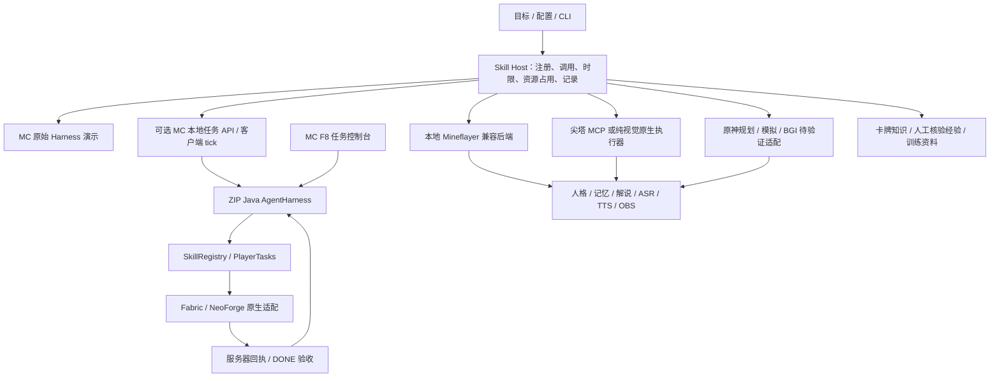

# MC Player Agent 与本地多游戏能力整合

本次以用户提供的 `MC-Player-Agent-0.4.0-alpha.1-GitHub.zip` 为 Minecraft 原生执行架构基线，保留所有 151 个文件及目录、原说明、配置 Schema、外部扩展示例、测试、来源与许可证。源码在 [mc-player-agent](../../mc-player-agent/README.md)，原始压缩包另存 `archives/`；[导入清单](import-manifest.json) 可核验原包和逐文件内容。Git 可依据原包自带属性规范换行，原包本身保持字节一致。整合补丁包括 MissionRun 测试等待修复、导演 API 的客户端挂接与说明更新；原始哈希、每项 diff、修复后哈希和独立新增文件均单独登记。原 Harness 的规划、原生动作和验收机制保留。

这是一个单仓库、多运行时的整合版本。Java Harness 仍是 Minecraft 原生执行核心，Node Skill Host 为现有运行时提供统一发现、参数校验、调用、取消与状态入口。没有把尖塔坐标和原神截图伪装成 Minecraft 的背包、坐标或服务器回执，也没有在 MC 控制器中另加规划循环。

当前实机验证遵循用户要求的 API 调用分工：导演控制台启动 Skill，DeepSeek API 决定游戏动作，本地视觉/CV/OCR API 提供当帧观测和定位，已有原生键鼠 API 执行，下一帧再由本地视觉核验。Codex 只负责接线、诊断、代码修复和任务监督，不代替角色选牌、指定游戏落点或手动推进。测试里的模拟决策不能记作这条真实 API 链路的运行结果。

尖塔本轮采用纯视觉执行路径，不用保留的 MCP 状态读取来补未知牌面。原神目前完成规划、诊断和受限观察入口，尚未接通完整执行闭环。原生 MC 新增默认关闭的导演 HTTP 任务通道，继续使用原包的结构化观测与服务端回执，并非纯视觉键鼠模式；接口测试和加载器编译不能替代选定存档中的真实验收。各入口的停止、超时、当前帧校验和后续观察同样适用于模型选择的恢复动作。

## ZIP 架构好在哪里

1. **慢规划与快执行分离。** Planner 异步返回计划；`AgentHarness` 在宿主线程推进。连续 Task 持有执行权，后台复盘不会随意替换正在执行的技能。这比每次模型回复直接下发一串按键更能保持任务连续性。
2. **回执与完成判定分离。** `tick` 只交付一次动作，`complete` 带回观察和回执；DONE 仍要通过核心 `goal_check`。这提供了追踪“计划正确但动作失败”的位置。
3. **运行有界。** 时间、请求、动作预算按会话累计，取消请求、遇险、换维度不会返还预算。停止后迟到模型回复不能重新夺回控制。
4. **扩展点可以实际编译。** 实例级 `SkillRegistry`、版本化 `AgentProfile`、`SkillProvider` 和 `ServiceLoader` 已有外部组合技能示例；生命周期包含暂停、恢复和停止，不是只有一份插件描述。
5. **可维护的模块边界。** Harness 不依赖游戏类，公共服务端代码不导入客户端类，Fabric/NeoForge 保持薄入口；纯算法能先离线回归。
6. **证据与来源可追溯。** MissionRun 按 UUID 记录，世界记忆按存档、玩家和维度隔离，配置哈希可核对；LICENSE、NOTICE 和 provenance 保留真实继承关系。

这些优点不等于已经完成通用插件平台。原包仍有 MC 语义、较集中的 PlayerControl、单项验收、未完成的客户端长期评测；同 JVM Java 插件也没有隔离不可信代码。

## 本地能力取舍

| 本地能力 | 处理 | 原因与边界 |
| --- | --- | --- |
| MC 原有模型规划/任务调度 | 保留在兼容后端，不移入 ZIP 核心 | 原生 MC 优先 ZIP 的 Harness，避免两个规划器同时接管一个玩家 |
| MC 生存反射、邻近/遮挡威胁、资源可达性、脱困 | 保留源代码及测试 | Mineflayer 观察与原生 MC API 不同；能迁移的是规则和失败案例，不能直接复用实体引用/坐标协议 |
| MC Qwen/DeepSeek/Astra-JEV 接入 | 保留兼容后端及历史配置方式 | 原 ZIP 的 DeepSeek/Ollama 配置继续独立；不复制真实密钥或自动改模型 |
| MC LoRA 训练与评测 | 保留数据、训练脚本、评测文档及本机权重索引 | v6r1 曾真实训练但因材料规划回退被拒绝部署；v4r1 只是回滚候选，不写成稳定生存已通过 |
| 尖塔 MCP 路线 | 接入 `sts2:play` | 复用动作白名单、状态新鲜度、实况复盘和主播同步 |
| 尖塔纯视觉原生输入 | 接入 `sts2:native-play` | 保留截图、Qwen 辅助定位、坐标约定、拖拽、急停和后续观察 |
| 尖塔训练/知识/经验 | 接入 `sts2:knowledge`、`sts2:learning-status`、`sts2:learn` | 区分游戏资料、OCR、模型推断、人工核验和有监督实战；不会把知识学习说成权重微调 |
| 原神/BGI | 保留规划、模拟、诊断和待接线适配 | 早期探索尚未完成，发现可执行文件不等于可以实机运行或验收 |
| 主播人格、记忆、语音、OBS | 原模块保留，统一上下文 Skill 接入 | 不加入 ZIP 游戏核心，保持任务执行与演出分工 |
| 运行日志、存档、模型大文件、私有记忆 | 本机保留并建立快照/索引 | 不混入公开源码或伪装成可复现测试夹具 |

本地 [MC 分析](../minecraft-agent-analysis-20261018.md)、[训练结论](../minecraft-local-qwen-training-results-20261013.md)、[长期实验](../minecraft-five-hour-experiment.md) 和 [DeepSeek 接入](../minecraft-deepseek.md) 保留。`vendor/minecraft-agent` 的兼容依赖按本地源码快照保留，来源与提交见 [清单](minecraft-legacy-source.json)；其固定种子历史成绩是该项目的报告，不能当作本次整合实测结果。

尖塔通关的逐回合材料在 [实战记录](../sts2-native-learning-2026-10-26.md) 与 [结构化经验](../sts2-native-experiences-2026-10-26.json)。历史结果为 48 层、“胜利……？”结算，方法是 Codex 监督决策、本地 Qwen 辅助视觉、项目原生键鼠。此次保留其证据，不重复声称整合后已再次通关。

## 当前统一层的精确边界

- 支持可信显式 provider 注册、实例隔离、封闭注册表、启用列表、参数校验、版本和调用配置哈希。
- 同一个 Skill Host 内实时游戏 Skill 共用 `desktop` 资源。取消/超时会转为 STOPPING，执行器确认空闲后才释放；断连时保持占用，不能因 HTTP 超时而放行另一个游戏。
- 外部手动控制台、原生 MC F8 及独立运行的旧服务仍有各自入口，**不属于统一层的全局进程锁**。不要同时通过不同入口控制同一身体。服务重启后的跨进程租约恢复尚未实现。
- 原生 MC 保留 F8/F9，并增加 `mcplayer:native-status`、`mcplayer:native-play`。HTTP 只提交目标与停止请求，客户端 tick 调用原 PlayerControl；存档、实例、请求与 mission 归属均核对。默认关闭，需配置本机令牌并显式选择存档；实机接管仍待验证。Mineflayer 兼容入口仍单独保留。
- 统一层时限覆盖整个 Skill 调用，步骤数由具体引擎校验；它不替代 Java 核心的模型请求/动作预算，也不声称能计算其他引擎的 token 成本。
- `COMPLETED` 表示只读 Skill 返回；`SIMULATED` 表示模拟；实机回执默认 `UNVERIFIED`。只有 provider 的独立证据验收通过才可 `VERIFIED`。停止不等于成功。

## 后续另一份项目如何加入

Java MC 插件继续按原包 [EXTENSIONS](../../mc-player-agent/docs/EXTENSIONS.md) 提供 `SkillProvider`，不要更换其接口。其他运行时实现统一层 provider 的 `validate/execute`，需要结果验收时提供 `verify`；用独立命名空间注册并提供取消、假成功和参数错误测试。[示例 provider](../../examples/skills/provider.cjs) 可直接运行。

未来真正需要跨环境共享 Java 核心时，先从尖塔/原神的实际证据定义环境协议，再做有版本迁移的接口演进。当前整合不以无类型 JSON 取代原 ZIP 已有的明确类型和验收约束。
