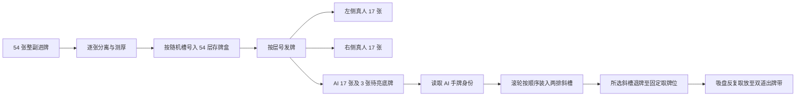

# 小型实体斗地主机｜整机设计

采用可见三仓机械洗牌和四轴关节臂的后续版本见[三仓洗牌、斜槽理牌与机械臂出牌](mechanical-doudizhu-machine-design.md)。本页保留紧凑方案的设计记录。

这版采用立式分度存牌盒自动洗发牌、两排遮光斜槽实体理牌、短行程吸盘逐张出牌。普通扑克牌从一个入口装入。左、右两个短出口发给真人，机器保留自己的牌。公共视觉与语音共同核对真人回合。手牌区有独立直播镜头。

## 洗牌与自动发牌

1. 一次装入 54 张正面朝上的普通牌。开始前对 54 个槽号执行 Fisher–Yates 随机排列。橡胶送料轮、可调限缝、厚度检测和两组光电门逐张确认进牌。分度升降轴把随机选中的空层对齐固定送料口，把当前牌送入该层，每层有导向和止挡。54 张全部入盒后，从上到下已经构成实体随机牌序，才能开始发牌。 [NIST Fisher–Yates 算法](https://xlinux.nist.gov/dads/HTML/fisherYatesShuffle.html)
2. 盒内前 51 层按左、右、AI 轮流分配，末 3 层留作底牌。推指将目标牌送入夹送轮，按层号顺序抽出要对外发的 34 张。真人牌经过共用翻面机构，通过转向门从左右出口分别背面朝上发出。AI 对应的 17 张留在原层。输送确认失败时暂停并保留槽位状态与分配，清障后核实对应层再继续。
3. 地主确定后，三张底牌经公开小窗展示。AI 当地主时，三张牌走内部识别和排序通道。真人当地主时，底牌经对应侧口交给该玩家。理牌最终库存为 17 张或 20 张。

洗牌位置和牌面识别分开控制。真人牌路径只启用过牌检测。私有读牌仅在选定的 AI 槽号被送往整理通道时启用，底牌在亮牌阶段再读取。

## 斜槽如何实现实体排序

1. AI 选定的牌依次送到遮光读牌口。相机读取 `点数、花色 → 盒内层号`。每张牌读完由可逆夹送轮退回原层，确保第二遍能按选择顺序抽取。也可在原型阶段采用专用侧置读牌窗来减少一次滚轮往返，但需要现场验证光路和定位。
2. 默认按斗地主点数从 `3` 到大王，同点数按固定花色顺序排序。花色优先模式把花色设为第一关键字，组内再按点数排序，大小王独立收尾。软件得到目标排列，同时控制电机执行实体重排。
3. 分度升降轴按排序结果逐张找层，抽出后通过两路分流门，送到上层两排各 10 槽的牌架。每排用同步带分度头和可逆夹送轮对齐目标槽，短翻转导槽把平面通道接到斜槽。牌沿自身长边滑入对应卡道，同排卡道适度错层形成扇叠，露出每张的角标。挡唇和到位检测保持牌序。斜槽内排成真实的点数序列，例 `3♣、3♥、5♠、9♣、9♦、K♥`。
4. 遮光罩、两侧隔板和后挡板挡住两个真人座位的视线。罩内相机从牌面正上方偏斜拍摄，画面中显示两排角标。直播使用该相机的画面。用现场两个座位和直播机位做三视角验收，比赛现场屏幕需要避免回显到玩家视线内。

## 吸盘如何连续出多张

斜槽分度头反向送出所选牌，短翻转导槽回到水平，夹送轮把牌送到唯一的固定拾取位。短行程 X/Z 滑台配软吸盘，在固定取点和放点间重复移动。吸盘离开取位并通过吸附反馈后，送料机构即可预送下一张，传感器负责互锁。无人手进入取放机构的正常工作路径。

公共区使用可展开的双道出牌带，根据牌宽和角标位置采用错叠铺牌，覆盖最多 20 张同组牌。送牌带按固定节距前进，第一道装满后切换第二道。拼组期间界面显示正在出牌，只有相机核对所有牌与合法动作一致才提交回合。中途失败锁定当前动作、保留已出牌记录，禁止盲目重发整组。

## 真人回合的视觉和声音

外部顶置相机拍两块公共出牌区。牌面稳定时，通过 OpenCV 读取点数和花色，输出牌组和置信度。左右麦克风接现有 SenseVoice，把“对九”“三个七带一张五”“过”等词句归一为点数、数量和过牌事件。语音可以独立辅助提交过牌，条件是本轮对应座位、桌面无新牌并满足当前可过牌；首版保留实体确认键。两路一致且动作通过规则校验就提交。视觉看不全或两路冲突时，冻结回合并提示重摆或确认。说话可以核对点数和牌型，具体花色由视觉读取。 [SenseVoice 官方仓库](https://github.com/QwenAudio/SenseVoice) · [DouZero](https://github.com/kwai/DouZero)

## 硬件与样机验收

| 模块 | 组成和要求 |
| --- | --- |
| 进牌与防双张 | 叠牌仓、橡胶分离轮、阻滞片、可调限缝、弹簧测厚触头及位移传感器、两个光电门。单靠光电计数无法发现完全贴合的双张。按所选牌组标定厚度，疑似异常时停机。 |
| 立式洗发牌盒 | 54 张独立薄隔片、导轨、步进分度轴、原点开关、层位置校验、公共推指和夹送轮。2.2 mm 层距假设下，54 层节距约为 119 mm，另计上下边界和驱动空间。重点验证远端分度、开槽精度、满载摩擦、卡牌可清理性。 |
| 左右发牌与底牌 | 共用翻面机构、左右分流门、两个背面朝上的短滑道、底牌展示小窗。每个分支安装过牌反馈。 |
| 斜槽与实体排序 | 两排各 10 张、约 45–60° 可调倾角、错层薄导轨、分度头、可逆夹送轮、短翻转导槽。以 63 mm 宽牌和约 14 mm 露边节距为排布示例，单排理论宽约 189 mm，外框与驱动另计。按牌的长边滑入滑出，验证相邻牌不会互相拖拽，以及相机能读清每个角标。 |
| 紧凑吸盘 | 短行程 X/Z 滑台、软吸盘、气泵、真空开关、固定取牌台、可展开双道出牌带。定点取放减少运动距离。整组提交前逐张记录实物状态。 |
| 感知和控制 | 机内读牌相机与补光、罩内直播镜头、外部公共相机、左右麦克风、控制板及传感器接口、开盖停机/急停、故障复位。读牌和直播镜头分别优化光路与画面。 |

外壳占地以 **320 × 260 mm** 为结构排布目标，侧接牌滑道、可展开公共出牌带和相机支架另计。按约 119 mm 盒体层距和约 117 mm 升降行程估算，整盒移动的竖直包络已约 236 mm。斜槽尽量与升降机构错开布置，机身高度暂按 **280–320 mm** 做泡沫板排布。最终尺寸根据机械干涉、驱动安装空间和翻面通道的实体样板调整。

先做 **6 层存牌盒 + 6 槽斜架**台架，用刻意打乱的牌验证真实重排，再做左、右和保留三路分发及连续 5 张吸盘出牌。同步测试疑似双张和视觉语音冲突。扩到全量后增加 54 张库存核对、17/17/17/3 分配、三张底牌去向、20 张实体排序，以及最长出牌组与两个玩家座位的遮挡测试。记录洗发牌时间、理牌时间、单张节拍、整组耗时、卡牌次数和双张漏检。当前为方案与布局设计，相关性能均待实测。

## 概念图

[下载带中文标注的概念图](compact-doudizhu-machine-concept.png)。剖面用少量隔层和牌展示原理，外形比例和出牌带展开尺寸以样机为准。概念图使用内置 ImageGen 生成及修订。

生成和修订提示词

Use case: infographic-diagram. Create one wide landscape presentation-ready annotated product engineering concept illustration for a compact tabletop automated Dou Dizhu machine. Exact simplified Chinese title «小型实体斗地主机｜洗牌、发牌与理牌». It should look like a CUSTOM low rectangular appliance approximately 30 cm wide, shorter than a desktop keyboard, with rounded dark matte enclosure, a small linear suction carriage built into the front (no large articulated robot), and two shallow card chutes coming out on opposing left/right sides. No weighing station, no flat full-card egg-crate tray, no human figures, no loose components spread over the tabletop. Render a human players' view on the main large 3/4 image: on top an opaque hood fully hides the CPU's cards from both player seats, to the left and right short chutes dispense face-down cards, front narrow public belt displays three distinct contiguous face-up cards with clearly visible corners. Show top camera on a short foldable bridge aimed OUT at the public playing mat with two marked player card areas indicated simply with silhouettes, two low microphones on its sides, a single full-deck input slot on top behind the hood. One compact inset top right shows the INTERNAL CAMERA VIEW of the ordered private cards inside the hood: two rows of ten angled cards, side-overlapped like a clean fan showing every index corner from smallest to largest, exactly two banks, plausible normal playing cards, matte black inner side shields, no transparent windows. One compact side section inset bottom shows layered architecture with lower motorized thickness-indexed buffer cassette with many thin horizontal pockets, central rubber transport rollers, shaded upper tilted two-bank card display under hood and small linear vacuum head that picks from a single fixed horizontal pickup point and places onto the public belt. Use simple orange arrows for physical card motion. Exact clean black simplified Chinese callout text, no English, 8 short legible labels and clear leader lines, arranged around the main device and insets: «① 整副进牌｜自动洗牌», «② 左右出口｜各发十七张», «③ 内部暂存｜按牌序取出», «④ 遮光斜槽｜实体排好», «⑤ 罩内镜头｜直播看手牌», «⑥ 定点吸盘｜逐张出牌», «⑦ 公共出牌带｜多张成组», «⑧ 桌面相机与麦克风｜核对真人出牌». Use restrained slate, white, teal and orange on a light neutral background with high contrast. Bottom small line exactly «概念示意 · 外形与行程待样机验证». Prioritize legibility and compact layout, rendered machine should resemble a single appliance on desk. No decorative objects, no logos, no watermarks, no product claims.

Make a targeted engineering annotation correction to the provided compact Chinese Dou Dizhu concept infographic. Preserve enclosure, graphics, layout, color, title, views, generous margins, and other labels. In the upper-right private camera inset show clearly physically sorted cards by Dou Dizhu rank, reading upper row then lower row, simple high contrast index text. Exactly render upper row left to right: 3♣ 3♥ 4♠ 4♦ 5♣ 6♠ 6♥ 7♦ 7♣ 8♠. Lower row left to right: 8♥ 9♣ 9♦ 10♠ J♥ Q♦ K♠ A♥ 2♣ 2♥. Replace the misleading ③ label pointing to this inset with exact Chinese «⑤ 罩内镜头｜直播看手牌». Keep ③ only pointing to lower internal pocket cassette. Remove the ⑥ callout below front display in the large main view, keep ⑥ only on the suction head in the side section. Preserve ⑦ in main view and add a small realistic deployable two-lane card tray immediately extending forward out of the panel with the three played cards sitting on the tray, not inside the machine. Remove the duplicate ④ leader in the main view if needed, preserve ④ in cutaway. The result should stay wide and clean, no extra notes or labels.

