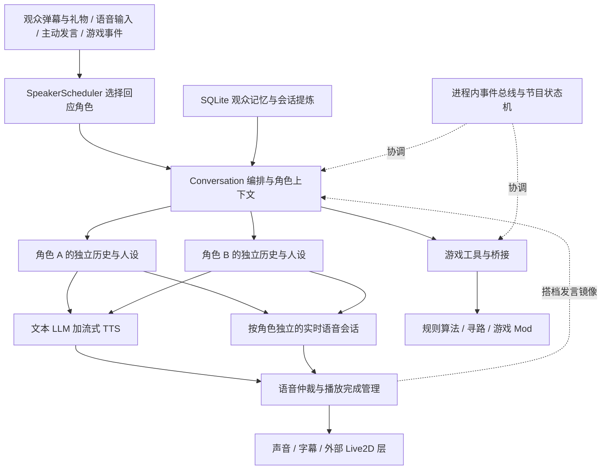

# Lumi_Nox 架构分析与姬岁歌项目借鉴

Lumi_Nox 最值得借鉴的是双角色共享直播舞台时的调度工程：谁回应观众、谁持有发言权、如何让搭档知道刚才发生了什么，以及如何让游戏操作与解说配合。公开仓库提供了这些机制和游戏实现，但完整直播运行入口、真实人格、Live2D 表演层及导演控制台未随之公开。适合阅读和移植机制，不能把运行演示等同于复现作者直播。

## 分析版本与验证范围

- 分析日期：2026 年 10 月 10 日。
- 来源：[MIO-456/Lumi_Nox](https://github.com/MIO-456/Lumi_Nox)。
- 本地下载：`E:\Github\Lumi_Nox`，独立于当前 AI_vtuber 仓库，使用 `git clone --depth 1` 下载当前快照。
- 提交：`77f973431c49f5ab72d3b2501c0e89286997ec46`，提交时间为 2026 年 8 月 14 日 20:20:02 +0800。
- 快照共 89 个 Git 跟踪文件；其中 Python 文件 60 个，约 28,049 行，另有 C# Mod、Lua 和网页资源。
- `python -m unittest discover -s tests -v`：7 项测试通过，其中包含实际运行 `main.py` 的子进程测试。`python -m compileall -q .` 通过。
- 验证范围为源码分析、公开测试和标准库行为复现；没有调用付费模型、连接直播间、启用麦克风或运行游戏。真实语音延迟、双角色长时间稳定性和游戏效果尚未在本机验证。

仓库 README 将自身定位为 open-core；LICENSE 标为 MIT。角色提示词、声纹、运营数据和商业游戏本体不在公开交付范围内。

## 整体架构

这张图概括模块职责和预期集成关系；公开 `main.py` 只接通其中的事件总线、状态机、调度器、仲裁器和模拟大脑，不是完整生产装配图。

主体采用 Python 单进程模块化结构，内部结合线程、异步 WebSocket 和队列；词语游戏另起求解子进程，游戏 Mod 是外部执行端。它不是分布式多智能体平台，也不是训练两个独立模型的训练框架。

### 两条语音路线

| 路线 | 主要链路 | 架构特点 |
|---|---|---|
| 文本模式 | 输入文本或 ASR → 角色上下文 → OpenAI-compatible LLM → 分句流式 TTS → 播放 | 人设、工具和输出文本较容易控制；`run_architecture.py` 默认是 `text` |
| 实时模式 | 音频或文本注入 → 角色自己的豆包 SC2.0 WebSocket 会话 → 返回文本与音频 | 同一角色的理解与语音生成交给实时服务；客户端负责归因、打断、输出设备和会话同步 |

实时聊天是否启用，同时取决于运行模式和当前是否处于 `CHATTING`。文本发声又通过 `TtsEmitter` 抽象为 `feed / finish / abort`：可以用独立 CosyVoice，也可以借实时服务合成文本。两种模式是替代和复用关系，不能简单理解为每条回复都依次经过两套模型。

源码入口：[运行模式](../../Lumi_Nox/run_architecture.py)、[发声策略](../../Lumi_Nox/tts_emitter.py)、[实时会话](../../Lumi_Nox/realtime_chat.py)。

## 双角色协作的关键机制

### 调度器决定谁回答

`SpeakerScheduler` 管理 `active_speakers` 和轮换游标。一条输入通常选择一个角色回应；正文只提到一个角色名字时优先选择该角色，否则按轮换顺序。

这里所谓的“@ 路由”实际使用大小写不敏感的名字子串匹配，不要求存在 `@`，也没有完整的别名或词边界解析。移植到中文双人格时需要考虑名字出现在普通词语中的误命中。

弹幕进入队列后会去重。消息过多时，SC、上舰和礼物全部保留，普通弹幕优先取较新内容，进房互动优先级较低。付费消息甚至可以超过 `max_items`，说明它偏向直播运营中的付费回应，但并未提供严格的上下文长度上限。

源码入口：[speaker_scheduler.py](../../Lumi_Nox/speaker_scheduler.py)。

### 独立上下文与搭档镜像

每个角色的 `FastBrain` 保存自己的 `history` 和 `system_prompt`。文本路线把 A 的发言写入 B 的历史时，采用带说话人前缀的 `user` 消息，而不是把 A 的话写成 B 的 `assistant` 消息。

实时路线采用更明确的旁白包装：把“观众问了什么、搭档回答了什么”一起放入 `[直播提示]` 用户消息，再加一个简短的 assistant 承接。这能减少角色把搭档说过的话当成自己经历的风险，但仍然依赖模型遵循角色约束，不是强制的事实隔离。

两个 `FastBrain` 实例不等于两个独立训练的模型。公开实现的模型客户端和当前模型选择仍是模块级共享变量，角色之间主要隔离提示词和历史。

源码入口：[conversation.py](../../Lumi_Nox/conversation.py) 中的 `mirror_speech_to_partner`、`build_realtime_mirror_qa`；[fast_brain.py](../../Lumi_Nox/fast_brain.py) 中的 `FastBrain`。

### 发言权与声音生命周期

`SpeechOutputArbiter` 单独控制当前有效输出，提供三种策略：等待当前输出、忙时丢弃、打断当前输出。每次发言有 `output_id`，可以关联底层 `task_id`，供取消和完成判断使用。

它解决的是“哪次发声有效”，调度器解决的是“下一轮谁回答”，二者需要分开。文本生成结束、服务端合成结束、客户端播放结束是三个不同时间点。`lumi_tts.py` 会额外等待客户端播放状态，避免下一位在上一位尾音结束前开口；实现还包含估时和截止时间，因此不应据此宣称绝对不会叠声。

实时引擎的 `SessionRuntime` 分角色保存 WebSocket、音频队列、输出设备及 `task_id / question_id / reply_id` 映射。取消时丢弃旧响应，防止过期音频重新进入播放链。这些状态比简单的全局 `isSpeaking` 更有复用价值。

源码入口：[speech_output_arbiter.py](../../Lumi_Nox/speech_output_arbiter.py)、[lumi_tts.py](../../Lumi_Nox/lumi_tts.py)、[realtime_chat.py](../../Lumi_Nox/realtime_chat.py)。

## 记忆系统

记忆采用 SQLite，区分观众原始消息、观众事实与摘要，以及角色消息、角色事实与摘要。观众身份优先使用 `bili:{uid}`，避免仅靠昵称识别人；旧数据使用 `legacy:{昵称}`。

流程为：直播时记录消息并检索已有记忆，下播后提炼事实和摘要，再在后续对话中按身份与相关性注入。支持批处理提交、结果获取和补处理，不必让记忆提炼阻塞每次回复。

值得借鉴的细节有：

- 观众事实默认按 168 小时半衰期衰减，强度低于 0.1 时不注入；只在读取时过滤，不直接删除数据库行。人工事实和身份类别不衰减。
- 上舰记录由确定性逻辑提炼为身份事实，避免完全依赖 LLM 猜测付费身份。
- 摘要靠关键词与文本片段匹配；这部分是轻量检索，不是向量语义检索。
- **自我事实与自我摘要默认不注入。** `build_memory_context(..., include_agent=False)` 的默认值在 `MemoryRuntime` 调用中未被覆盖。代码注释说明，这是为减少临时话题变成长久设定、跨场重复旧梗的问题。

最后一点尤其适合姬岁歌：长期记忆并非注入越多越好，应区分角色设定、已核实经历、短期话题和节目梗。

一个需要改进的身份边界是：带 UID 的观众发言时，如果找到唯一同名 legacy 记录，当前实现会自动认领。昵称唯一匹配仍不能证明是同一个人，迁移到正式观众数据库时应保留验证或人工处理路径。

源码入口：[检索](../../Lumi_Nox/memory/retrieval.py)、[衰减](../../Lumi_Nox/memory/decay.py)、[运行时](../../Lumi_Nox/memory/runtime.py)、[上舰事实](../../Lumi_Nox/memory/guard_facts.py)。

## 游戏能力如何实现

公开游戏模块的共性是读取结构化游戏状态，再由算法或 LLM 选择动作，通过桥接执行。不能把这些效果直接解释为通用截图识别和鼠标操作能力。

| 游戏 | 决策与执行结构 | 可借鉴之处 |
|---|---|---|
| 恶魔轮盘 | TCP 状态桥接，按当前道具和局面生成可用动作工具 | 工具参数只开放合法动作，让解说对应实际动作 |
| 泰拉瑞亚 | Python 高层目标与组合行为，C# tModLoader Mod 提供状态和 A* 寻路等执行能力 | 高频运动交给本地算法；LLM 处理较低频的目标决策 |
| 王国保卫战 | Lua 游戏桥接，算法生成和执行建塔方案，LLM 选择开局并为后续波次提供策略偏置 | 策略与执行分层；异步计算下一波策略，失败时可回到算法逻辑 |
| Wordle 与汉兜 | 专用词库、候选过滤和熵求解，独立 worker 进程 | 把计算密集任务从主播主进程移开 |

双角色还区分游戏操作者和旁观者。操作者获得动作工具，旁观者主要接收解说上下文；部分流程每手先安排旁观发言再安排操作，避免两位都抢着决策，也减少旁观者把对方操作说成自己的操作。

泰拉瑞亚公开 Mod 还处理窗口失焦后的控制标志重置和后台暂停问题，这是特定游戏集成的工程成果。它与本项目的桌面视觉控制路径不同，不能直接替代明日方舟的观察、定位和执行适配。

源码入口：[游戏目录](../../Lumi_Nox/games/README.md)、[泰拉瑞亚执行端](../../Lumi_Nox/games/terraria/mod/LumiBridge/LumiBridgeSystem.cs)、[王国保卫战 AI](../../Lumi_Nox/games/kingdom_rush/ai.py)、[求解进程客户端](../../Lumi_Nox/games/word_games/solver_client.py)。

## 公开实现的边界与问题

以下区分已经复现的行为和根据源码作出的工程判断。

| 项目 | 证据与影响 |
|---|---|
| 排队登记没有自动消费 | 已复现：Lumi 占用输出时让 Nox 排队，再完成 Lumi，结果为 `queued_count=1`、`is_busy=False`，启动事件只有 Lumi。仲裁器没有出队执行接口，公开调用代码也没有消费者。要实现真正“排队后播放”，必须补充携带内容与执行回调的待播任务队列。输入弹幕队列是另一套队列，不受此结论影响。 |
| 完整装配入口缺失 | 多个模块由 `lumi.py` 初始化或注入回调，但此文件不存在；`ConversationContext` 定义存在，公开仓库没有实例化它的生产入口。`persona/character_a.md` 等默认文件也不存在。补密钥和安装依赖仍不足以一键开播。 |
| 事件总线是同步执行 | `publish` 逐个直接调用订阅回调；锁保护订阅表不等于异步调度。慢回调会阻塞发布线程，`request` 的等待超时也不能抢占前面已经阻塞的回调。耗时工作应交给线程、任务或进程。 |
| 会话对象与可变全局并存 | `SessionRuntime` 已拆分，但 `_runtime_context` 仍切换模块级状态。源码记录过跨角色连接混用的问题；移植时宜让处理函数显式接收 session 对象，降低并发维护难度。此处不是声称当前已复现串话。 |
| 求解隔离有降级边界 | worker 失败后，`best_guesses_or_fallback` 会同步调用进程内求解。正常路径隔离了计算，但故障路径可能重新阻塞调用线程。 |
| 配置与依赖尚不完整 | requirements 未锁版本；音频依赖 PyAudioWPatch，部分游戏依赖 Windows API。王国保卫战策略模块导入时即检查 `KR_ARK_API_KEY`，而 `.env.example` 没列此项，所谓 dry-run 也应先核对导入路径。 |
| 测试覆盖有限 | 7 项测试覆盖演示、记忆衰减、上舰回填幂等和泰拉瑞亚打包源码检查；并不覆盖真实双会话乱序、音频设备、取消竞态、模型失败或长时间运行。编译通过也不会验证运行时依赖齐全。 |

此外，`conversation.py` 约 1,539 行，`realtime_chat.py` 约 2,491 行，泰拉瑞亚 `bot.py` 约 6,309 行。它已经做出模块边界，但部分文件仍承担大量职责，更接近持续演进的直播系统快照，而非稳定的通用 SDK。

## 对姬岁歌项目的采用建议

当前 AI_vtuber 使用 Node.js 服务和浏览器舞台，已有角色包、人格情绪、记忆审核、ASR/TTS 适配、流式取消与播放队列。相关入口包括 [brain.js](../src/brain.js)、[stream.js](../public/stream.js)、[request-lifecycle.js](../src/runtime/request-lifecycle.js) 和 [项目交接](../PROJECT_HANDOFF.md)。这次对本项目的对照限定在这些入口和交接说明，不是全面审计。

建议保留现有框架，按以下顺序移植机制：

1. **先做独立的岁与歌运行状态。** 分开角色卡、对话历史、情绪和表达状态；共享经过审核的世界事实与观众身份底账。明确哪类经历属于身体共同经历，哪类只是某人格的发言或主观感受。
2. **增加角色选择与表现权限。** 角色选择器决定谁回应；统一输出管理器控制声音、字幕和 Live2D。姬岁歌是同一身体双人格，默认一个人格控制表现，切换必须取消旧任务并传递新的身份标识。
3. **接入搭档镜像。** 用明确的说话人和事件类型记录另一人格说过什么，不把这些话写成当前人格自己的 assistant 历史。镜像只提供上下文，不自动升级为长期事实。
4. **统一任务归因。** 在现有 request lifecycle 和取消机制上贯通 `personaId / turnId / outputId / generationEpoch`，同时处理 LLM、TTS、字幕和动作，防止切换后旧音频或旧表情回流。
5. **游戏采用单操作者。** 一个角色拥有动作权限，另一角色可以解说；权限校验放在工具执行端。长期再拆“目标选择 → 游戏策略 → 原子动作 → 结果验证”，复用现有游戏适配。
6. **评估记忆相关性而非扩大注入量。** 保留人工确认和证据链，增加临时话题衰减、观众是否在场、不同人格经历归属的测试。

第一轮验收应覆盖：连续轮换不串人设；点名选择正确；打断后无旧音频和字幕；TTS 故障能释放发言权；排队请求可以执行或过期清理；旁观人格不能操作游戏；共同事实与私人表达不会混写。

不建议整体复制 Python 全局状态结构、按估时判断播放完成的细节，或为了复用项目而重做现有 Node.js 系统。最有价值的是调度与归因机制，以及让确定性执行和角色表演各自承担合适的职责。

## 推荐阅读顺序

先运行和阅读 [main.py](../../Lumi_Nox/main.py)，再依次看 [调度器](../../Lumi_Nox/speaker_scheduler.py)、[语音仲裁器](../../Lumi_Nox/speech_output_arbiter.py)、[对话编排](../../Lumi_Nox/conversation.py)、[角色大脑](../../Lumi_Nox/fast_brain.py)、[记忆检索](../../Lumi_Nox/memory/retrieval.py)，最后看实时协议与游戏模块。这个顺序能先理解控制流，再处理音频和游戏的大量细节。

## 岁与歌首轮适配源码（2026-10-10）

本轮在现有 Node.js／浏览器架构内实现同一身体、手动切换人格。借鉴上述职责划分，未直接复制上游 Python 实现。

| 职责 | 本项目源码 | 当前行为 |
| --- | --- | --- |
| 岁／歌角色卡 | [jisui.js](../src/character/jisui.js) | 分别定义表达规则；数值人格基线继承 generic，尚未进行独立校准 |
| 上下文隔离 | [reply.js](../src/brain/reply.js)、[brain.js](../src/brain.js) | 按人格检索各自最近四轮；伙伴发言以带归属的 user 上下文提供；情绪与认知分别持久化 |
| 任务失效 | [persona-runtime.js](../src/runtime/persona-runtime.js) | 服务实例 ID、personaId、generationEpoch、turnId；切换和手动停止使旧代数失效并广播 AbortSignal |
| 发言仲裁 | [speech-output-arbiter.js](../public/speech-output-arbiter.js) | 浏览器播放队列支持 queue／drop／interrupt、过期清理和 outputId；过期完成回调不能释放新输出的发言权 |
| 字幕与表情 | [persona-presentation.js](../public/persona-presentation.js)、[stream.js](../public/stream.js) | 拒绝旧代数、旧轮询和已退役服务实例的结果；切换立即清空旧输出并恢复中性表情 |
| 网络取消 | [request-lifecycle.js](../src/runtime/request-lifecycle.js)、[server.js](../src/server.js) | 取消连接与上游请求；提交记忆前再次检查有效性；过期 TTS 请求返回 409 |

取消分两步：先同步提高 generationEpoch，撤销旧任务资格；再尽力中止请求、清空播放队列、停止已调度音频。即使上游忽略取消，晚到结果也无法提交当前人格的记忆或重启本页旧播放。turnId 用于轮次归因，outputId 由本页仲裁器分配；当前不是跨机器统一的输出租约服务。

共用观众事实检索、关系底账与已确认的日程。旧角色训练记忆没有人格归属，暂不作为岁／歌的自传注入。普通聊天中自动推断的未完成事项仍属于各自认知状态，并非全部转换成共同承诺。语音通话历史仍按通话隔离，弹幕历史仍按观众及场次隔离。

服务默认启用双人格，设置 `DUAL_PERSONAS=false` 可恢复 `CHARACTER_PACK` 单角色模式。舞台新增人格选择和“停止当前发言”入口。未重启现有服务；尚未做真实语音设备和长时间直播验收。未新增独立声音权重、外观切换、情绪触发自动切换或游戏控制权分配。

已通过 `npm run test:personas`、`npm run test:realtime`、`npm run test:voice-call`、`npm test`、`npm run test:character`、`npm run test:runtime`，以及语法和差异空白检查。新增行为验收位于 [dual-persona-runtime.js](../tests/dual-persona-runtime.js)；浏览器回调竞态检查位于 [frontend-realtime-behavior.js](../tests/frontend-realtime-behavior.js)。
