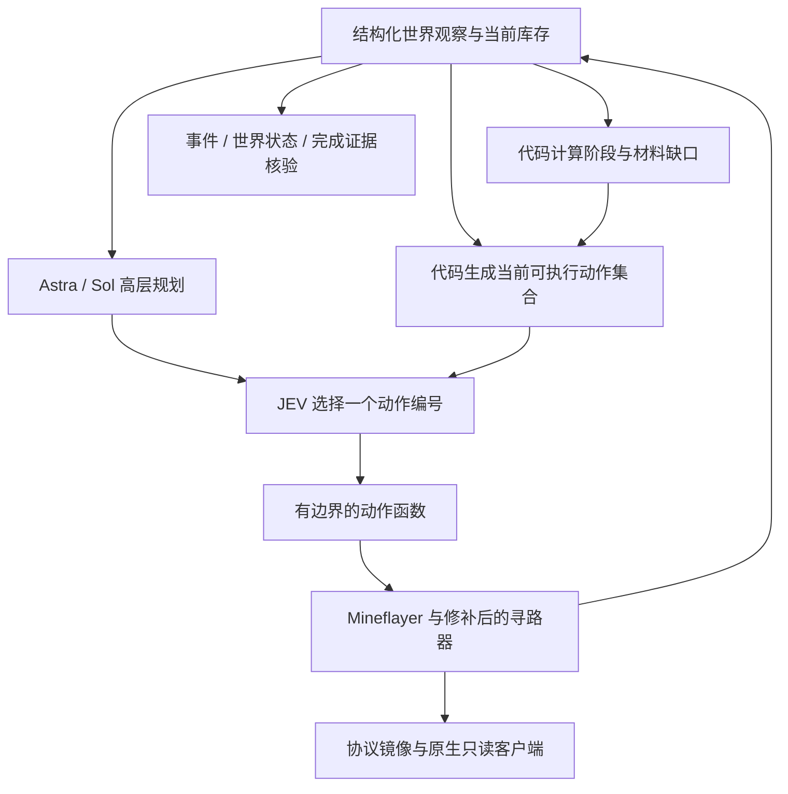

# rmalde/minecraft-agent 下载与源码分析

分析日期：2026-10-18（用户本地日期）。仓库：https://github.com/rmalde/minecraft-agent 。

下载位置：`E:/Github/AI_vtuber/vendor/minecraft-agent`。固定提交：`78b40ed59514e5e2abde33a05ce398ecb2c39e05`；该提交时间2026-09-19。使用浅克隆，未启动服务器、游戏、录像或模型调用，未接入现有机器人。当前工程的Minecraft任务与自动监督继续保持用户要求的停止状态。

## 1. 结论

它有值得借鉴的执行工程：阶段状态机、按现场生成合法动作选项、低频规划与动作执行分离、短段导航、寻路库补丁、物品/窗口校正、危险处理和完成证据检查。

但它公开描述的最快结果属于**固定种子、和平难度、已勘察路线、已知补给和天然激活末地门**的受控演示，不能直接解释为任意世界中的稳定生存，也不能直接与本工程当前世界的建家任务比较。它的Easy完整流程在后续开发笔记中仍明确写着未完成。

**两边锁定的底层库版本相同：Mineflayer 4.39.0、mineflayer-pathfinder 2.4.5。** 差异不能归纳成“对方用了更可靠的另一套Mineflayer”。我们的集成、执行策略、模型与任务条件都需要分别看。

## 2. 实际架构

- `nether-agent.mjs` 是README最新和平路线入口；`eyes-agent.mjs` 是需要末影之眼材料的Easy路线入口。不能把所有入口当成同一个已验证版本。
- `models.mjs` 的规划器使用OpenRouter聊天接口，默认 `openai/gpt-6-astra`，可选 `openai/gpt-5.6-sol`。
- JEV通过 `/api/alpha/decisions` 接收结构化状态与 `a0/a1/...` 候选项，只选择当前候选动作。它不是向模型展示所有接口、让模型任意拼参数；动作、物品数量、目标坐标有大量前置条件和程序逻辑。
- `stage()` 按 prepare → entry → nether → stronghold → combat → exit 推进，补给缺口由库存与固定路线目标计算。具体路线、箱子和床的位置由代码/配置提供。
- `async-planner.mjs` 保留一条正在进行的规划请求。首次有计划后，高层规划异步刷新，默认阶段不变时15秒间隔；阶段变化时丢弃旧阶段响应。高层请求失败不会抹掉现有计划。
- 主入口的大阶段和路线主要由程序决定；Astra的objective通过状态提供给JEV，不等于模型从零发现完整速通路线。部分阶段只提供一个或极少数候选动作，JEV的选择空间由程序限定。
- 动作循环仍需等待JEV决策，不能把它说成完全不依赖模型延迟。

本工程当前 `autonomy-loop.js` 主要是每步等待Qwen规划，再发技能；有安全层和受限的前瞻缓存，但没有同等的独立JEV动作选择层。小模型直接面对完整75动作合同，与它的高层规划＋现场候选选择，任务难度不同。

## 3. 为什么寻路看起来更可靠

### 3.1 路线被提前解决了很大一部分

`optimization/nether/config.json` 固定Java 1.16.5、和平难度、种子 `8398967436125155523`，包含村庄、三个补给箱、八张床、出入下界门、下界路点、末地入口的坐标。箱子合计提供21黑曜石及铁镐、铁、燧石；末地门已自然激活，因此该演示不需要完整的烈焰棒与珍珠收集链。

这不是证明它作弊；这是必须披露的基准条件。README也主动说明了固定路线与预先勘察。和平难度不会验证普通夜间僵尸/骷髅围攻、饥饿与长期房屋生存策略。

### 3.2 分段行走与结果区分

- `nether-agent.mjs` 的 `segment()` 将长距离接近切成约24格段，`go()` 完成后检查实际距离。
- `navigation.mjs` 将接近目标裁成短段，区分“真的到达”“有实质位移但尚未到达”“完全没动”。
- 失败候选有冷却，阶段完成后从动作集移除已完成的工作；`selectUsefulOptions()` 有有效动作时去掉普通等待。
- 不等于“所有移动功能全部无约束开启”：当前和平入口明确 `allowParkour=false`、`maxDropDown=3`、较高液体代价、允许垫柱，并对岩浆、龙息和边角做排除。它依靠具体风险规则，不是一律关闭或一律放开。

### 3.3 自行修补了寻路器，而不是只让模型反思

`patch-pathfinder.mjs` 修改依赖副本，包括：

1. 取消/停止导航时清理旧的搭桥返回目标。
2. 用navigation epoch防止取消后延迟放块回调恢复旧状态。
3. 修补空失败路径被当成成功，以及有可走部分路径的搜索超时被立即拒绝。
4. 分离走路方向与连续相机朝向，放块/跳柱前等待瞄准。
5. 停止时清控制键，避免直接重写玩家位置/速度。

本次在**隔离副本**中成功运行补丁，未改动本工程实际依赖，并做了两类事件复现：

| 模拟事件 | 本机原版2.4.5 | 应用该项目补丁后的副本 |
|---|---|---|
| `noPath` 且 `path=[]`，目标并未到达 | Promise成功返回 | 拒绝并报告NoPath |
| 搜索timeout但已有可走路径，之后触发goal_reached | 立即拒绝Timeout | 保持等待，最终成功 |

这证明一个真实的库级行为问题，不能归咎于语言模型。它也不能证明本工程所有失败都源于此：我们的技能有部分额外距离/物品验证，具体动作仍须逐条核对；通用goto包装本身未统一做goal终点检查。

## 4. 生存、战斗、物品和画面

### 生存与战斗

Easy分支提供 `hostile-defense.mjs`、`night-safety.mjs`、`nether-workshop.mjs` 等：识别指定敌人、检查可见性、预判猪灵蛮兵、清头顶后垫柱、盾牌与有冷却的有限近战、夜间找床/放床/清床位、白天回收并核验床入库、补充损坏工具和旅行材料。

这些具体动作比单纯说“遇敌攻击/低血量逃跑”完整。但该仓库的Easy笔记同时记录了导航掉岩浆、材料不足重复失败，以及末影龙床战尚未解决，不能把组件代码等同于完整生存可靠性。

### 物品与成功证据

- `inventory-recovery.mjs` 处理游标物品、窗口同步与转移失败，避免把“物品挂在鼠标游标上”误判为丢失或工具损坏。
- 动作后记录真实位置和当前库存；采集尽量接近真实掉落物。
- 末影龙完成条件不只看模型一句“赢了”：`evidence.mjs` 区分击杀进度、零血量＋死亡阶段和出口事件；`verify-run.mjs` 还读取世界NBT、游戏模式/难度、源文件哈希、动作日志和录像覆盖。
- 不是所有函数都做了严格物品增量验收。例如入口的mine函数返回“挖掘并接近掉落物”，不能自动当成目标物品数量已满足。

### 原生镜像画面

`native-mirror.mjs` 在本机25578建立只读协议镜像，原生Minecraft客户端连镜像，不是用户玩家用 `/spectate` 跟随真实服务器中的bot。它持续同步bot位置、相机、库存、游标和动画。

`native-client/NativeViewAgent.java` 还禁用显示窗口、抢焦点和鼠标定位，并限制显示客户端只连本机镜像。这样可以减少桌面输入和玩家旁观解绑对展示的影响；但不是直接复制一个JavaScript文件就能在我们机器上线。

该原生客户端/构建脚本使用macOS路径、Java运行时布局和平台参数；Windows与当前26.1.2客户端需要单独适配。龙头传感器通过Java agent读取1.16.5内部类字段，扩充了精确观察，版本耦合明显；并非仅靠普通玩家屏幕视觉。

本次未运行任何录像脚本。

## 5. 宣传结果和可验证范围

作者README称最新 `nether-final-08` 为8分43.300秒、131次JEV决策、35次Astra调用、无死亡。这些是**作者报告**，本次未独立复现。

`runs/`、录像、世界存档与生成证据被.gitignore排除，公开下载不含所称完整视频、events.jsonl或world-proof。因此目前无法独立检查该次成绩、每一步是否模型选择、完整录像是否覆盖全部动作。

更重要的是，`optimization/eyes/SESSION-NOTES-20260919-0924.md` 明确写了Easy目标未达成、End未解决、现有 `end-combat.mjs` 为实验版本，旧和平成功源码在未随仓库发布的历史runs目录中。当前共享模块经过后续试验修改，不能保证直接运行HEAD就复现README旧成绩。应冻结已验证版本，而不是把开发中的共享模块与旧视频混为一谈。

## 6. 本次实际验证

- 静态核对：入口、模型调用、路线配置、寻路补丁、原生镜像、Java传感器、危险/物品处理与完成验证。
- 选取12个离线测试文件，执行46项测试：**45通过，1失败**。
- 失败项：`optimization/pass-2/policy.test.mjs` 的“有实质移动的超时不算路线失败”。假bot未提供 `blockAt()`，而当前 `approachEndCover()` 新增了地形/净空检查。该失败说明测试夹具没有同步，不足以单独证明真实机器人会在这一处失败。
- 隔离复制同版本寻路器，运行项目补丁后，**4项取消/延迟回调测试全部通过**，并观察到上表两类goto行为发生变化。
- 离线测试借用了父工程现有同版本JS依赖。没有在新机器做完整npm安装，没有跑API、服务器、原生客户端或通关。
- 没有执行npm生命周期脚本，没有修改本工程运行源码、实际node_modules、游戏世界或已停止的自主任务。

原始输出：`output/minecraft-agent-analysis-tests-20261018.txt`；隔离验证：`output/minecraft-agent-pathfinder-audit-20261018/RESULT.json` 和 `test-output.txt`。

## 7. 接入本工程的优先级（本次仅分析）

| 优先级 | 可借鉴点 | 实际收益 | 需要验证 |
|---|---|---|---|
| P0 | 寻路结果、取消与延迟回调的契约测试 | 降低没走到却成功、取消后仍回旧目标等问题 | 在本工程独立分支上验证；本次没有应用补丁 |
| P0 | 当前合法动作集合＋材料缺口 | 减少小模型编造参数、重复合成和空手战斗 | 保持用户要求的全部能力注册，只按当前前置条件生成候选 |
| P1 | 阶段持久化、完成里程碑、短段导航 | 减少大目标丢失和无限重试 | 换世界/死亡后失效旧观察，不能照搬固定坐标 |
| P1 | 将高层规划与短动作调度分开 | 模型慢时不让所有执行工作串行等待 | 只执行仍有效且已授权动作，保留停止与危险响应 |
| P1 | 真实库存/游标/方块结果作为验收 | 减少“挖了等于拿到”“接口接收等于完成” | 对采石、做剑、建屋逐项测增量 |
| P2 | 协议镜像渲染 | 稳定展示bot画面、减少玩家旁观依赖 | Windows原生客户端、26.1.2协议和OBS桥接适配 |

不能直接搬：固定种子箱子/床/传送门坐标、和平难度下省略食物与防具的策略、1.16.5私有协议字段和Java类名、macOS启动路径、Google Secret Manager项目配置。

下载根目录未发现LICENSE/COPYING文件，package.json也未声明项目许可证；依赖包的许可证不等于仓库原创代码的再使用授权。代码整合或对外再分发前应先核实作者授权。架构思路可以用于评估和自行实现。

## 8. 主要源码定位

以下链接固定到本次下载提交，避免main后续变化：

- [README与结果边界](https://github.com/rmalde/minecraft-agent/blob/78b40ed59514e5e2abde33a05ce398ecb2c39e05/README.md)
- [主入口与候选动作](https://github.com/rmalde/minecraft-agent/blob/78b40ed59514e5e2abde33a05ce398ecb2c39e05/nether-agent.mjs)
- [模型调用与类型化选择](https://github.com/rmalde/minecraft-agent/blob/78b40ed59514e5e2abde33a05ce398ecb2c39e05/models.mjs)
- [异步规划](https://github.com/rmalde/minecraft-agent/blob/78b40ed59514e5e2abde33a05ce398ecb2c39e05/async-planner.mjs)
- [固定路线配置](https://github.com/rmalde/minecraft-agent/blob/78b40ed59514e5e2abde33a05ce398ecb2c39e05/optimization/nether/config.json)
- [寻路器补丁](https://github.com/rmalde/minecraft-agent/blob/78b40ed59514e5e2abde33a05ce398ecb2c39e05/patch-pathfinder.mjs)
- [Easy后续开发状态](https://github.com/rmalde/minecraft-agent/blob/78b40ed59514e5e2abde33a05ce398ecb2c39e05/optimization/eyes/SESSION-NOTES-20260919-0924.md)
- [只读协议镜像](https://github.com/rmalde/minecraft-agent/blob/78b40ed59514e5e2abde33a05ce398ecb2c39e05/native-mirror.mjs)
- [完成验证](https://github.com/rmalde/minecraft-agent/blob/78b40ed59514e5e2abde33a05ce398ecb2c39e05/verify-run.mjs)
