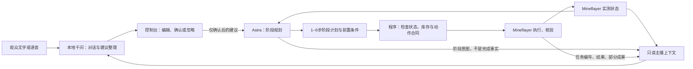

# Astra 游戏规划与本地千问主播

用户选择：Astra 按阶段规划、异常时重规划；千问整理观众建议，控制台确认后才交给 Astra。

## 分工和数据流

千问收到：当前目标、阶段意图、动作状态、最近一分钟内同一世界和生命周期的结果、血量、饱食度、实际背包数量、位置、维度、最多四个附近威胁，以及建议是否待确认/已提交/已考虑。状态每约1.2秒采样，超过6秒视为过期，隐藏旧库存和结果。它不接收 API Key、控制令牌、完整执行返回或模型思考过程。

当前 Astra 模式的口播依据是结构化状态，不读取游戏截图。不应声称“看见了画面”。原有 OBS 视觉口播保留给旧模式。

| 数据条件 | 千问应该怎样表达 |
| --- | --- |
| 只有阶段计划 | “准备先收集木头。” |
| 动作 running | “正在尝试采集，还没有完成确认。” |
| completed 且 verified，未标记部分完成 | “刚才这一步已完成。”只指该步 |
| 部分完成 | “只拿到了一部分，还没做完。” |
| failed / rejected / cancelled | 如实说明失败或停止，不能套用上一任务的成功 |
| 避险、低血量 | 根据状态提醒，不能断言安全 |
| 断线、状态过期 | “暂时收不到游戏实时状态，不能确认进度。” |
| 建议待确认 | “建议已整理，等控制台确认。”不能说已执行 |
| 建议 confirmed / considered | 分别代表送入下一轮、已供规划考虑，都不证明采纳或完成 |

主动游戏口播采用用户选择的严格模式：程序从状态生成事实句，千问只从有限的、不包含游戏进度的短句中选择情绪或互动补充。非合法选择会被舍弃，不回退到自由生成事实。播出排队前再次核对事实句是否已变化。文字和语音观众问答仍由千问自由生成，使用相同事实上下文和边界提示，不能把自由问答当成执行证据。

## 阶段执行

Astra 通过官方 Responses API，使用 `gpt-6-astra`，每次返回1–6步和每步前置条件。只有前一步完整且已核验、现场状态保持一致、生命/饥饿/材料条件成立，才复用下一步。程序仍在实际执行时检查配方、数量和结果。

失败、部分完成、世界/生命周期变化、意外库存/位置变化、危险、确认新建议、停止任务都会使剩余步骤失效；阶段计划最多有效3分钟，步骤衔接超过15秒也重新规划。不自动执行模型提供的任意代码。条件不成立时返回 Astra 重规划，没有第二个游戏决策模型。

千问和 Astra 推理独立：观众可打断口播，不取消正在执行的 Mineflayer 技能或 Astra 请求。千问对话/口播失败时不回退到付费云端对话；主动口播可只播放程序事实句。建议整理使用本地千问单独一次短调用；同时只整理一条，最多五条待确认，十分钟过期，重启后清空。它不是自动汇总全部直播间弹幕：当前入口为 Minecraft 面板的文字和已接入的语音转写，并须勾选整理建议。

## 配置

打开 `http://127.0.0.1:3000/minecraft.html`，选择“Astra 玩游戏 · 本地千问互动”。在“Astra 专用”密码框输入官方 OpenAI API Key，保存，再点击“检查 Astra 连接”。检查只调用一次模型，不执行游戏动作。

密钥保存在已被 Git 忽略的 `data/minecraft-engine.local.json` 的 `astraApiKey` 字段，或设置服务端环境变量 `ASTRA_API_KEY`。不复用项目的 `OPENAI_API_KEY`，因为现有聊天配置可能把它用于其他供应商；旧 OpenRouter 密钥也不会发送给 OpenAI。密钥不写在网页代码、浏览器持久存储或状态响应中。配置文件为本机明文，依赖操作系统账户权限保护。

本地千问默认地址 `http://127.0.0.1:11435/v1`，模型 `qwen3.5-4b`。主播文本沿用现有语音/Live2D输出链路。进入 Java 世界并开放局域网后，仍需机器人真实连接成功才能开始游戏任务。

API参考：[Astra 模型](https://developers.openai.com/api/docs/models/gpt-6-astra)、[API Key](https://platform.openai.com/api-keys)。

## 验证

`node tests/minecraft-astra-streamer.js` 覆盖单次 API 多步复用、库存变化/失败/确认建议触发重规划、专用密钥隔离、无效/未完成响应、取消、建议确认边界、本地口播、过期和跨生命周期结果隔离。

其他回归：`minecraft-loop`、`minecraft-loop-life-memory`、`minecraft-partial-evidence`、`minecraft-planner-context`、`minecraft-commentary-scheduling`、`minecraft-commentary-routing`、`minecraft-chat-grounding`、`minecraft-continuity`。

测试中的模拟游戏状态不是真实游戏完成证明。Astra API 联通和真实世界端到端执行，必须在填入有效密钥并连接世界后另行验证。

2026-10-18 本地实测：千问能生成待审核建议；自由口播曾把目标数量误作已采集数量，因此用户选择了程序事实句＋千问受限情绪补充。未经密钥与真实世界联通验证，不宣称 Astra 已玩通游戏。
