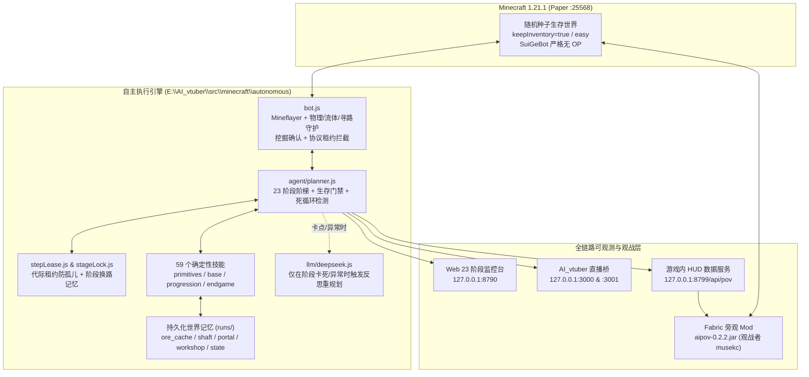

# Minecraft 1.21.1 全自主速通机器人：训练方法论、交付物总览与工程实战手册

> **生成时间**：2026-11-27  
> **代码仓库**：`https://github.com/Antares-Ji/AI_vtuber`（开发分支：`musekc_mc`，最新已验证提交：`0c91b57`）  
> **本地工作区**：`E:\AI_vtuber`（主工程与集成仓库）、`E:\ai_mc`（实验环境、文档与 Fabric 旁观 Mod 源码）  
> **目标受众**：接手或基于本套成果继续训练/扩展自主游玩机器人的协作者与算法/工程研发

---

## 一、项目总览与核心设计哲学

本项目的目标不是做一个“靠 Prompt 临场发挥、演示 3 分钟”的玩具 Bot，而是构建一套**在 Minecraft Java 1.21.1（Paper 服务端）严格无作弊（`MC_ASSIST=0`）随机种子下，能够从零撸树一路自主推进到击杀末影龙（23 阶段）的工程化自主智能体框架**，同时完整打通直播互动、Web 实时监控与游戏内第一视角观战能力。

### 1.1 最核心的架构结论（给训练者的第一条经验）

> **不要让 LLM 直接输出底层按键/坐标操作，也不要指望纯 Prompt 工程解决物理与协议 Bug。**

我们验证最稳健、成本最低的范式是 **“确定性技能状态机 + 分层守护 + 按需 LLM 重规划”**：



- **成本与效果**：DeepSeek 仅在卡点或重规划时调用（开启 Prompt Cache 后命中率 ~78%，几十次调用成本仅约 ¥0.3~0.5），95% 以上的采集、合成、寻路、下矿、浇筑、战斗由确定性技能高速稳定完成。
- **可复现与可训练性**：每一个现场遇到的卡死都被沉淀为 **“最小根因修复 + 离线 Mock 回归测试”**（当前已积累 **33 组自主核心回归测试 + 24 组 skills 协议测试**），确保改 A 不破坏 B。

---

## 二、制作成果与交付物全清单

### 2.1 核心代码与模块目录（`E:\AI_vtuber` 分支 `musekc_mc`）

| 模块类别 | 文件路径 | 核心职责与交付内容 |
| :--- | :--- | :--- |
| **启动入口** | `scripts/minecraft-server.js` | 启动并托管 Paper 1.21.1 服务端（`:25568`），自动保留已有存档、设置控制台规则 `keepInventory=true` / `difficulty=easy`、为观战者 `musekc` 配置 OP 与自动夜视，**绝不给 Bot OP**。 |
| **自主主进程** | `scripts/minecraft-autonomous.js` | 启动 `SuiGeBot` 自主速通进程（推荐带 `MC_ASSIST=0` 等 4 个严格无作弊开关）。 |
| **监控面板** | `scripts/minecraft-panel.js` + `src/minecraft/autonomous/panel/server.js` + `ui.html` | 独立 Web 监控台（`http://127.0.0.1:8790/`），实时展示 23 阶段进度条、血量/饥饿/氧气、坐标/维度、背包明细、阶段耗时、LLM 账单与缓存命中率、在线日志。 |
| **第一视角 HUD** | `scripts/minecraft-pov.js` + `src/minecraft/autonomous/pov/server.js` | 向游戏内 Fabric 客户端 Mod 提供毫秒级 JSON 状态接口（`http://127.0.0.1:8799/api/pov`）。 |
| **环境自检** | `scripts/minecraft-doctor.js` | 一键检查 Mineflayer 生态依赖、59 个技能注册、23 阶段阶梯、守护导出与 DeepSeek Key。 |
| **底层连接与守护** | `src/minecraft/autonomous/bot.js` | 封装 Mineflayer 1.21.1 客户端：流体状态机（干地 `liquidCost=35` / 湿态 `85`）、禁止 `bot.dig` 流体/空气、事件驱动挖掘完成确认、挂起 `pathfinder.goto` 显式 reject 守卫、仅头部浸水才触发的防溺水接管、全操作租约校验。 |
| **规划与调度中枢** | `src/minecraft/autonomous/agent/planner.js` | 23 阶段主循环、生存门禁（`survive`）、低血防死亡螺旋守卫、静默超时熔断（`STEP QUIET ABORT`）、头部浸水窒息中断（`STEP AIR ABORT`）、步骤退出自动关闭遗留窗口、实时心跳写盘 `runs/live.json`。 |
| **并发与防卡死基础设施** | `src/minecraft/autonomous/stepLease.js`、`stageLock.js` | `stepLease` 代际租约：步骤超时/结束瞬间立即吊销旧代际，彻底拒绝孤儿协程的移动/挖掘/点窗口/扔物品；`stageLock`：记录阶段尝试次数、无进展超时、自动换路与触发 LLM 重规划。 |
| **1.21.1 网格合成器** | `src/minecraft/autonomous/gridcraft.js` | 绕开 Mineflayer 1.21.1 原生配方书失灵问题，直接通过 2x2 / 3x3 窗口点击网格合成（含 1.21 工作台输出槽检测、自动清扫残留合成格、支持钓鱼竿/面包/工具/护甲/末影之眼等全配方）。 |
| **持久化世界记忆** | `oreCache.js`、`shaftRecord.js`、`portalRecord.js`、`workshopRecord.js` | 跨重连/跨死亡持久化保存矿脉/岩浆/地表水源/黑曜石坐标、矿井竖井坐标、下界/末地传送门坐标、工作台/熔炉点位；支持 `forget` 清理同坐标全部失效记录。 |
| **技能库（59 个技能）** | `src/minecraft/autonomous/skills/{primitives,base,progression,endgame}.js` | 完整覆盖采集、合成、工具保底、智能整理、狩猎/浆果/钓鱼/腐肉食物链、深层竖井、找钻、黑曜石浇筑与农场、搭/点下界门、找堡垒打烈焰人、刷末影珍珠（末影人+猪灵交易）、无作弊末影之眼定位要塞、末地炸水晶与屠龙。 |
| **直播桥接层** | `src/minecraft/autonomous/host/bridge.js` | 将 23 阶段进度、实时事件同步给 `AI_vtuber` 主服（`:3000`）做直播解说与观众互动。 |
| **游戏内旁观 Mod** | `E:\ai_mc\viewer-mod` → `aipov-0.2.2.jar` | Fabric 1.21.1 客户端 Mod，实现自动 `/spectate SuiGeBot` 锁定第一视角与左上角中文 HUD（阶段/血量/饱食/坐标/背包/下一步计划）。 |
| **自动化回归测试集** | `tests/minecraft-autonomous.js`、`tests/skills-*.cjs` | **33 组自主引擎回归测试** + **24 组 skills 协议/边界测试**，接入 GitHub Actions CI（`Agent skills integration`），已连续 25+ 次全绿。 |

### 2.2 23 阶段速通里程碑阶梯（`LADDER`）

| 阶段区间 | 里程碑 ID | 核心验收标准与关键防卡死机制 |
| :--- | :--- | :--- |
| **前期基建（1~6）** | `wood` → `crafting_table` → `wooden_pickaxe` → `stone` → `stone_tools` → `food` | 保留至少 4~8 原木/工作台/木棍保底；`food` 支持浆果/畜牧/雪兔/海岸钓鱼/海带/荒芜群系打僵尸溺尸吃腐肉，以 `edible>=3 || food>=18` 闭环。 |
| **矿业与装备（7~14）** | `coal` → `iron_ore` → `iron_ingots` → `iron_gear` → `armor` → `diamond_pick` → `diamond_gear` → `bow` | 本地优先放置自带熔炉冶炼；铁镐/石镐自动分级，**钻石镐严格专留黑曜石与高阶矿**；`bow` 支持砍蜘蛛网/夜间打蜘蛛+打骷髅/流浪者补箭+寻鸡集羽。 |
| **黑曜石与下界（15~19）** | `obsidian` → `flint_steel` → `nether` → `blaze_rods` → `pearls` | 仅锁 `level=0` 源岩浆直降 `y=-52`、敲冰取水、先挖岩浆顶盖+内壁/同层精准浇水+回舀水桶；`flint_steel` 缺铁自动挖铁冶炼；`blaze_rods` 支持无箭近战；`pearls` 支持末影人近战+猪灵丢金交易。 |
| **终局杀龙（20~23）** | `eyes` → `stronghold` → `enter_end` → `kill_dragon` | 无作弊实体数据包追踪末影之眼三角定位要塞；末地无作弊弓射无笼水晶（6 级仰角校准）+ 搭柱拆笼 + 喷泉边停栖输出，验证击杀后写入 `runs/dragon.json` 与 `runs/victory.json` 并洁净停机。 |

### 2.3 一键运行与校验命令（PowerShell）

```powershell
# 1. 环境与回归验证（每次改动必跑）
Set-Location E:\AI_vtuber
npm run minecraft:doctor
npm run test:minecraft:autonomous   # 33 组自主核心回归测试
node scripts/skill-catalog.cjs --check
npm run test:skills                 # 24 组 skills 测试

# 2. 启动全套服务（分 5 个常驻终端/后台任务）
# (1) Paper 1.21.1 服务端 (:25568，保留已有存档)
node scripts/minecraft-server.js
# (2) 23 阶段 Web 监控面板 (http://127.0.0.1:8790/)
node scripts/minecraft-panel.js
# (3) AI_vtuber 直播主服 (http://127.0.0.1:3000)
node src/server.js
# (4) 游戏内 HUD 接口 (http://127.0.0.1:8799/api/pov)
node scripts/minecraft-pov.js
# (5) SuiGeBot 严格无作弊自主进程
$env:MC_ASSIST='0'; $env:MC_WORLD_RULES='0'; $env:MC_DAY_LOCK='0'; $env:MC_NO_SELF_OP='1'
node --max-old-space-size=4096 scripts/minecraft-autonomous.js
```

> **局域网联机观战说明**：服务器已绑定 `0.0.0.0:25568`（`online-mode=false`, `white-list=false`），客户端版本 **Java 1.21.1**，本机连 `127.0.0.1:25568`，同局域网协作者连 `<宿主机局域网IP>:25568`（观战请切旁观模式，勿向 Bot 丢物资）。

---

## 三、训练与工程迭代方法论（如何把 Bot 训练得越来越稳）

我们从 0/23 推进到无作弊稳定跑过前期全部 14 阶段并攻克黑曜石全链路的过程中，沉淀了一套可直接复用的 **“6 步实战闭环训练法”**：

1. **严守“无作弊纪律”才能暴露真问题**：
   - 早期一旦开启 `/tp`、`/give`、`/effect` 或回血作弊，90% 的工程缺陷（寻路卡水、石镐耗尽、水桶打不上水、浅水误判窒息、搭柱摔死）都会被掩盖。必须长期在 `MC_ASSIST=0` + `MC_NO_SELF_OP=1` 下实盘跑随机种子，才能把所有长尾缺陷逼出来。
2. **用“实时遥测日志 + 状态快照”定位根因，拒绝拍脑袋调参**：
   - 每 4~5 分钟巡检 `runs/live.json`、`runs/state.json`、`runs/ore_cache.json` 和原始进程日志。
   - **铁律**：绝不靠猜测改 Prompt；每一个卡死都能在日志里找到精确到行号的物理/协议/状态机因果链（例如：`roam` 在 `y=18` 洞里找牛转了 311 秒，或 `bridge_to` 传了 `(0,0,0)` 方向向量空转 500 次）。
3. **里程碑不可逆原则（防止进度震荡）**：
   - `planner.js` 的 `REVALIDATE` 集合**只允许放状态型门禁**（`food`, `armor`, `nether`, `enter_end`），**绝不能放消耗品/易磨损工具**（木镐、石镐、铁镐、钻石镐、黑曜石、打火石、末影珍珠）。工具磨损由具体使用它的技能前置自愈，否则进度会在 12↔16 阶段无限倒车。
4. **任何修复必须附带一条离线 Mock 回归测试**：
   - 在 `tests/minecraft-autonomous.js` 中用轻量 `makeBot()` 构造精确的故障场景，毫秒级验证修复生效并永久锁进 CI。
5. **安全边界热更新（Hot-Redeploy Discipline）**：
   - 绝不在打开工作台/熔炉窗口、正在搭柱或末地打龙中途杀进程；等待回到陆地/步骤边界再热重启 `SuiGeBot`，同时保留 `runtime/minecraft-autonomous` 整个世界与 `state.json` 继续跑。
6. **把“前瞻审计”前置到当前阶段之前**：
   - 在 Bot 还在做第 15 段 `obsidian` 时，就提前审计第 16~23 段代码在 `MC_ASSIST=0` 下是否隐含 OP 依赖（我们正是这样提前发现并修复了 `flint_steel` 不挖铁、`farm_blaze` 无箭死锁、`farm_pearl` 猪灵交易错误、`kill_dragon` 无作弊射水晶逻辑）。

---

## 四、核心踩坑与实战经验详解（34 笔真实提交沉淀）

以下按工程专题梳理本轮 34 笔提交（`28c9c4d` → `0c91b57`）解决的最关键问题，协作者训练自己的 Bot 时可直接对照避坑：

### 4.1 并发控制与“孤儿协程”灾难（最高优先级架构坑）
- **现象**：步骤超时后主循环进入下一步，但前一步里挂起的异步 `await` 在 10 秒后突然恢复，偷抢手部装备、乱放工作台、乱点合成窗口导致背包物品丢失。
- **解法**（`f14513f`, `baf6e4a`）：
  - 引入 `stepLease` 代际锁，`lease.run()` 结算或超时瞬间立即 `revoke()` 递增代际号；
  - 在 `bot.js` 层统一包装 `goto / dig / placeBlock / equip / activateBlock / clickWindow / toss / tossStack / openContainer / openFurnace`，代际过期直接拒绝；
  - `planner.js` 每步退出时强制关闭残留的 `bot.currentWindow`。

### 4.2 Minecraft 1.21.1 协议与 Paper 服务端物理特性坑
1. **挖到一半就转头**（`baf6e4a`）：Mineflayer 的 `bot.dig` 在延迟环境下可能早于服务端方块更新返回，改为事件驱动等待目标格方块更新确认。
2. **原地跳跃却永远放不下方块**（`b34d03c`, `0c91b57`）：
   - 禁用 pathfinder 1x1 塔跳，路径卡顿守卫忽略纯 Y 轴原地弹跳；
   - `climbOut` 跳跃轮询加密到 **25ms** 抓腾空顶点；落地前等待 `onGround` 再判脚下方块，悬空边缘先横移到实心地面；
   - 修复 `climbOut` 阶梯回退条件反写（`isAir(stand)` → `!isAir(stand)`），2 次跳放失败自动改挖 1×2 实体岩阶上爬。
3. **1.21 工作台窗口输出识别失效**（`5f15809`）：在 `gridcraft.js` 中增加 1.21 输出格显式检测与残留清理。
4. **对液体/空气调用 `bot.dig()` 无限挂死**（`4748bbb`）：在 `bot.js` 全局拦截拒绝 `lava / water / air / cave_air / void_air / bedrock` 的 `dig`。
5. **浅水“脚湿头干”误判窒息劫持**（`a63c7ff`）：改为**仅当头部方块真正为 `water`** 时才触发防溺水接管与窒息中断。

### 4.3 寻路、水体卡死与桥梁搭建坑
- **水体成本与挖掘策略**（`2dec016`, `0db921b`）：干地 `liquidCost=35`、湿态 `85` 且 `canDig=false`；`dry_escape` 优先寻找 12 格内干岸走/游出去。
- **挂起的 `pathfinder.goto()` 永不结束**（`3b19b19`）：由 `path guard` 包装外层 Promise 并在停滞 28 秒时显式 reject，根治 181 秒静默卡死。
- **`bridge_to` 非法方向向量 `(0,0,0)` 死循环**（`30e3e2d`）：改为只选正交邻接面，并加连续 3 次拒放中止 + 死亡重生位移检测。

### 4.4 工具链、背包经济与本地冶炼策略
- **钻石镐保护与便宜石镐自动补给**（`2dec016`, `aa96ca6`, `a63c7ff`）：严格保留钻石镐专挖黑曜石；普通挖矿缺石镐时自动执行原木→木板→木棍→工作台→石镐整链补给；6 处普通岩体挖掘全部改用便宜镐。
- **背包整理保底原则**（`3b19b19`, `72a6a81`）：保留 `<=8` 原木、工作台、应急腐肉（上限 8），优先丢弃杂物。
- **本地冶炼与重生保护**（`fee6c15`）：优先使用 16 格内熔炉或就地放自带熔炉，重生远离旧熔炉超过 36 格立即中止回走。

### 4.5 极端群系生存与食物/箭矢经济
- **冰海/雪地针叶林缺粮与缺箭**（`2f31cfd`, `f14513f`, `932cf17`, `7e941ae`）：甜浆果丛、海岸钓鱼、雪兔、荒芜群系打僵尸溺尸保底；`<12` 箭矢保护、不可达猎物 2 次跳过、夜间打骷髅补箭；地下 `y<52` 找地表牲畜自动回地表/快退（`f17958a`）。
- **血量/饥饿守护阈值解耦**（`82daf2d`, `882bfe7`, `0742b6d`）：无食物时不让 4 秒看门狗强停寻路；地下 `survive` / `death-spiral` 下调至 `HP < 14` / `HP < 10`。

### 4.6 黑曜石与流体物理（本轮最密集的硬核攻关）
| 遇到的现场问题 | 根因 | 最终稳健方案（提交） |
| :--- | :--- | :--- |
| 浇水全变成圆石 | 矿洞 `y=-30` 多为流动岩浆（`level>0`） | 仅筛选 `level===0` 源岩浆，阶梯下探至 `y=-52` 真正的平坦岩浆湖（`d104d3f`） |
| 冻海打不上水 | `y=61` 水源上方封着 `y=62` 冰块挡住桶射线 | 检测并先敲碎覆盖冰块使 `y=62` 化为露天水源（`8b664e4`） |
| 水源在 17 格外却空桶去挖岩浆 | `findBlock(40)` 命中跳过漫游，但 `cands` 过滤 `<=12` 格变空 | 8~40 格先走过去再打水、候选放宽至 32 格并写入 `oreCache`（`72a6a81`） |
| 地下 `y=30` 陷入流动瀑布死循环 | 先 `.slice(0,4)` 再判 `isFluidSource`，且仅 `y<5` 才回地表 | 先按 `isFluidSource` 且 `|dy|<=10` 过滤，无可用源水且 `y<56` 自动回地表打水（`4e53745`） |
| 浇水后没变黑曜石且水桶白空 | 桶射线忽略液体；岩浆源头顶有石块挡住水流 | 先挖掉 `p+(0,1,0)` 岩浆顶盖；优先瞄准 `p+(0,1,0)` 侧墙内壁 → 同层空位 → 边沿；无论成功与否都立即回舀水桶（`9e57b52`, `8581732`） |
| 穿墙卡在 5.4 格后拒绝浇水 | 隧道循环在 `<=6` 格停止，浇水循环要求 `<=4.5` 格 | 隧道推进至 `<=3.8` 格，浇水前允许补挖最后 1~2 格隔墙（`a63c7ff`） |
| 反复回访冰海下/浸水死岩浆 | `oreCache.forget` 只删第一条留残余；冷却被强行覆写 | `forget` 清除同坐标全部条目；零黑曜石/全水无干地/海面为水冰的岩浆自动遗忘，直挖陆地深层湖（`f17958a`, `30e3e2d`） |

### 4.7 观战体验与第一视角 Mod（`aipov-0.2.2.jar`）
- 服务端对观战者 `musekc` 自动给 `night_vision`；HUD 从 `127.0.0.1:8799/api/pov` 实时拉取阶段/背包/下一步计划。
- **已知小优化项**：Bot 热更新重启或跨维度切图瞬间，客户端发 `/tp @s SuiGeBot` 与 `/spectate SuiGeBot` 会收到原版“未找到实体”提示；后续可在 `aipov` 发指令前检查在线玩家列表包含 `SuiGeBot` 即可静默消除。

---

## 五、当前实盘验证基线与给协作者的下一步建议

### 5.1 当前实盘状态（截至 2026-11-27 21:55）
- **运行模式**：严格无作弊随机种子 `seed=401396616`（`MC_ASSIST=0`、`MC_WORLD_RULES=0`、`MC_DAY_LOCK=0`、`MC_NO_SELF_OP=1`）。
- **已通过里程碑**：**`14/23`**（`wood` 至 `bow`、`food` 全通，成功全自主采钻做出钻石镐、全套基础工具、弓箭、熟食、水桶，并已在冰海极端种子下现场验证浇出黑曜石、自动补石镐、自动遗忘冰海岩浆转向陆地直挖 `y=-52`）。
- **工程质量基线**：`33/33` 自主回归测试通过、`24/24` skills 测试通过、GitHub Actions CI 全部绿色。

### 5.2 给协作者继续训练/扩展的 5 条高收益路线

1. **以本引擎为“专家教师”采集轨迹数据集（Behavioral Cloning / Offline RL / SFT）**：
   - 在 `planner.js` 的 `runStep` 边界记录 `(state_snapshot, skill_name, args, result, delta_progress)` JSONL，低成本生成高质量“高层规划 + 异常处理”微调数据集，用于训练本地小模型替代云端规划器。
2. **多随机种子 Benchmark 评测体系**：
   - 批量跑 5~10 个不同群系种子（平原、冰海、沙漠、丛林、山地），统计各阶段通过率、耗时分位数、死亡归因分布，把优化从“单局救火”升级为“分布级泛化”。
3. **强化终局（17~23 段）无作弊实盘压测**：
   - 重点验证下界玄武岩/灵魂沙峡谷搭桥、恶魂击退生存、要塞水下/岩浆室定位、末地被龙击飞防虚空四类长尾场景。
4. **保持“技能原子化 + 回归测试先行”的研发纪律**：
   - 任何线上故障先写一条最小复现 Mock 用例进 `tests/minecraft-autonomous.js`，再改代码，避免回归。
5. **旁观 Mod 体验微调**：
   - 在 `viewer-mod` 中增加 `playerList` 在线校验，消除 Bot 重启期间的“未找到实体”提示。

---

## 附录：本轮完整提交历史（`musekc_mc`：`28c9c4d..0c91b57`）

- `28c9c4d` — 集成 23 阶段自主速通引擎并加固直播桥接
- `5f15809` — 修复 1.21 工作台窗口输出检测与过期解说清理
- `71ecf1f` — 集成独立 23 阶段 Web 监控面板（`npm run minecraft:panel`）
- `96852dc` / `055fdfe` — 修复找钻缺铁计算、自动升级铁镐与 `ensure_tools` 自愈
- `976a343` / `9525714` — 集成游戏内第一视角 HUD 服务、观战者自动夜视并同步技能目录
- `d68b191` — 补强蜘蛛网采集、循环续挖竖井与无作弊末影之眼实体追踪
- `2dec016` / `0db921b` / `baf6e4a` / `b34d03c` — 寻路流体策略、浅水干岸优先、事件驱动挖掘确认、禁用 1x1 塔跳与 25ms 跳跃顶点轮询
- `2f31cfd` / `f14513f` / `1b04197` / `932cf17` / `7e941ae` — 冰海针叶林食物与弓箭体系、即时撤销 `stepLease` 租约、下界/末地无作弊战斗打通
- `3b19b19` / `fee6c15` / `4748bbb` / `82daf2d` / `882bfe7` / `aa96ca6` — 挂起 `goto` 显式 reject、本地熔炉冶炼、全局禁挖流体、血量阈值与看门狗解耦、岩浆边缘停车与便宜镐守卫
- `d104d3f` / `8b664e4` / `9e57b52` / `0742b6d` / `a63c7ff` / `8581732` / `72a6a81` / `4e53745` / `f17958a` / `30e3e2d` / `0c91b57` — 黑曜石全链路攻关（源岩浆直降 `y=-52`、敲冰取水、先挖顶盖+侧壁直浇+水桶回舀、石镐木链全自动补给、浅水头干防误判、`flint_steel` 自动挖铁、12~40 格打水死区、地下流动水回地表、`oreCache.forget` 彻底清理、`bridge_to` 非法法向量修复、`climbOut` 实体岩阶修复）
