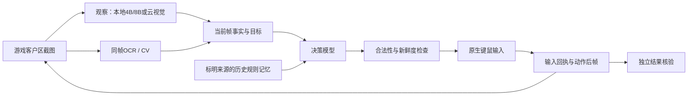

# 从“能操作”到“可比较”：杀戮尖塔 2 多模型智能体阶段研究

阶段报告暨论文雏形 v0.1 · 2026-11-01 · RTX 5080 单机

## 摘要

本研究以杀戮尖塔 2 为任务环境，考察大模型在观察、策略决策、原生键鼠执行和结果核验组成的闭环中，能力与延迟如何相互影响。现有工程已覆盖 Codex 监督的原生操作、DeepSeek 驱动的结构化接口，以及 DeepSeek 决策结合本地或云端视觉的原生操作。本文审计历史运行记录，并在 RTX 5080 上新增 Qwen3-VL 4B、8B 与 DeepSeek Flash 的同帧回放比较。当前证据支持链路可行性、具体失败模式和选定样本的接口性能比较；尚不足以证明纯本地模型自主通关、不同决策模型的胜率排序或参数量的因果收益。研究下一步应固定信息权限、代码版本、起点和记忆协议，以独立游戏尝试而非任务段或动作数作为胜率分母。

## 1. 研究对象：比较什么

用户提出的“Codex 跑、DeepSeek 跑、本地模型跑、脚本跑、CV 跑”涉及不同层级，须拆开后再比较。

| 编号 | 决策者 | 观察方式 | 执行方式 | 当前证据状态 |
|---|---|---|---|---|
| A | Codex/对话代理监督 | 截图，局部本地 Qwen 辅助 | 项目原生 Win32 键鼠 | 历史推进至第48层“胜利……？”结算；有监督，非无人基准 |
| B | DeepSeek | 游戏 MCP/结构化状态 | 结构化游戏动作/脚本 | 存在历史接管及运行记录；信息与动作接口不同，不能与纯视觉混算 |
| C | DeepSeek | 本地 Qwen3-VL + OCR/CV | 原生键鼠 | API闭环实测；存在战斗推进、重复观察、失焦和开发中断 |
| D | DeepSeek | DeepSeek Flash 云视觉 + 本地 OCR/CV | 原生键鼠 | 有实际出牌和继承残局的败北证据；后续新局仍未完成 |
| E | 本地模型 | 本地/固定观察 | 原生键鼠 | 尚无与C/D等价的自主策略完整试验；不能把本地读图当成本地决策 |

“脚本”可实现循环、规则、动作宏或结构化接口，并不天然与 CV 对立。CV 是观察/定位组件；原生键鼠是执行组件。以下先比较可核查的组成部分，再提出闭环方案。

结构化游戏状态是另一种观察条件，不能从旁路注入上述纯视觉试验。当前项目约定由 DeepSeek API 决策，Codex 监督开发；本轮未让 Codex 选择新游戏动作，也未更改这项约定。

## 2. 已经做到什么：历史证据

**监督链路已覆盖较长流程。** 10月26日文档记录 Codex 监督、Qwen 辅助读牌、原生输入的另一局到达48层，结算包含3首领、4精英。末段存在女王击败和建筑师剧情生命归零，标题为“胜利……？”。本轮没有重新逐图人工核验，因此按历史记录引用，不转换成后来 API 自主系统的通关成绩。[证据审计](history-evidence.md)

**API自主链路有推进，也有明确失败。** 10月30日起可识别67个近期任务段，包含反复启动、停止、修复和续跑，不能算67局。早期继承的一局确认两次进入奖励；云视觉阶段从3/80生命残局开始，确认两次拖牌与结束回合，随后败北。之后出现不同种子的新开局。最新日志截至2026-10-31 16:47:36 UTC（用户时区09:47:36），仍在战斗，未见奖励或终局，不能给它判胜或判负。[逐段记录与哈希](historical-summary.json)

最新任务段有16个被接受的决策、14个输入回执，其中5个是实际按下/移动/松开的拖拽序列，另外2个drag决策只准备起点。最后回执中键和鼠标按钮均已释放，但`game_verified:false`；这说明回执与游戏效果必须分开。

**等待与观察是可见的工程问题。** 早期49段快照覆盖约8小时03分；任务创建至末事件的区间合计约3小时21分，段间间隙约4小时42分。273个输入回执的物理动作仅合计351.19秒。间隙包含开发、测试和等待，不能全部归因于模型思考。历史Flash/low样本中规划均值约4.68秒，战场和手牌观察各约11秒；这些是不同阶段的实测口径，不是精确互斥的墙钟分解。[原性能报告](../../sts2-performance-assessment-20261030.md)

最近版本已经增加历史牌面规则记忆和动作证据帧复用，旧文档“每次重新完整读牌/非悬停后总是单独截图”的描述不再普遍成立。跨时间性能差异同时包含协议变化，不能都算作换模型效果。

## 3. 本轮新增：5080上三条件同帧回放

### 3.1 方法与环境

本机实测 GPU 为 NVIDIA GeForce RTX 5080，总显存16303 MiB，驱动616.92；Windows Python 3.12.14，PyTorch 2.11.0+cu128、Transformers 5.16.1、bitsandbytes 0.50.2。已存在完整4B与8B权重。两者使用NF4量化、BF16计算、相同本地观察代码与OCR检查。云端沿用官方DeepSeek Flash视觉链路，输出和图像传输由其服务处理，非本地推理。[环境记录](environment.json)

选择此前六个实际困难样本：手牌费用冲突、高体型敌人、完整牌面类型、抽牌堆界面、遮挡玩家生命、展开手牌。每条件预热一次，之后同一组六例重复三轮。固定随机种子打乱样本顺序；观察缓存被明确禁用。使用专用只读服务端口，不读取隐藏状态、不发送游戏动作。运行起止状态、源码哈希、图像哈希、原始输出、核对结果与请求时间均保留。

这里有6个选定样本，不是18个独立样本。预热、模型加载与正式请求分别记录；没有独立人工像素标签，因此不计算准确率。模型运行顺序固定，桌面其他应用未关闭；云端输入包装与服务端预处理不同，均为解释限制。

### 3.2 测量结果

<!-- REPLAY_RESULTS_START -->
三条件各18次正式请求全部返回，缓存命中均为0；另有每条件1次预热不计入下表。

| 观察条件 | 平均请求秒 | 中位请求秒 | 去代码围栏后JSON可解析 | 规范结果非空 | 请求后总显存最大采样MiB |
|---|---:|---:|---:|---:|---:|
| Qwen3-VL-4B / NF4 | 5.900 | 5.297 | 18/18 | 18/18 | 8490 |
| Qwen3-VL-8B / NF4 | 5.234 | 4.141 | 18/18 | 12/18 | 11959 |
| DeepSeek Flash 云视觉 | 3.124 | 3.117 | 18/18 | 18/18 | 4178 |

8B有12次原文带Markdown代码围栏，直接按JSON解析仅6/18；去围栏后才是18/18。4B和云端原文均18/18可解析。显存数字包含桌面及其他程序，只是请求后采样最大值，不是模型独占显存或推理峰值。云端数字仅是本机占用，不包含服务商GPU。模型/服务加载分别36.109、21.110、0.516秒，受磁盘缓存及固定顺序影响，不据此比较模型加载效率。未获得完整计费token与账单，本报告不估算云端费用；显卡采样也不足以推算整局电费。

本组云端平均请求时间比4B低约47.1%，但仅是六类指定输入的接口均值，不能外推整局加速。云端在遮挡生命小输出样本上反而较慢（2.511秒，对比4B的1.558秒）；4B与云端的完整牌面耗时也相近。详细逐例三轮记录见[结果表](replay-tables.md)和[原始回放](replay-20261101T141827Z/results.json)。

输出检查发现：

- 8B两类手牌样本在三轮中均返回顶层数组，当前接口要求`cards`对象，6次均为`Missing bounded hand observations`，规范结果为null。这些请求未执行后续手牌OCR核对，故较低耗时还混入了处理路径缩短，不能全归因于更快推理。
- 完整防御牌样本中，4B与云端的名称、类型、规则得到同帧OCR支持；8B牌名为null、结果保持不确定。费用不在该完整牌面独立核对字段中。
- 遮挡生命样本中，三个条件的规范结果均保留未知，没有用模型猜测填入生命或格挡。
- 4B/8B将抽牌堆原始分类为selection，已有OCR分支把结果标成抽牌堆查看并移除候选；云端三轮中1次分类为menu，未触发相同的selection/unknown核对分支，仍保留6个启用卡牌候选；另外2次为selection并被OCR核对分支纠正。这是本轮发现的观察与校验分支缺口，尚未发送动作或验证其实际后果，不能称为已修复。
<!-- REPLAY_RESULTS_END -->

图1：柱为每个样本三次请求均值，误差线为观测最小值至最大值，不是置信区间。图中衡量观察接口墙钟时间，不是出牌速度或通关率。

### 3.3 如何理解这些结果

较低延迟与可用输出必须同时检查。HTTP请求成功、JSON可解析、规范字段非空、字段正确和动作有效是五个不同层级。即使规范结果非空，也可能包含未知生命或被拒绝的牌面。较大模型若返回接口不接受的字段类型，会造成集成失败；这种现象应单独报告，不能冒充识别错误，也不能在计时后偷偷修正并算作原生成功。

旧六例测试合计4B为42.010秒、8B为42.545秒、云端为8.997秒。它与本轮的重复数、当前代码、提示、缓存控制和系统负载不同，不能混在一起算平均值。本轮是新的探索性重复测量，不是对旧数值的覆盖或同版本严格复现。

## 4. 论文雏形：研究主张与相关工作

建议暂定题目：**《资源受限桌面环境中视觉游戏智能体的分层评测：杀戮尖塔2的探索性研究》**。

论文主张可落在“识别、决策、执行与验证分别计量，揭示低成本混合代理的闭环失效”，而不是现在就宣称哪个模型最强。当前可能形成的工作贡献是：一套可追溯原生闭环、困难帧回放与分层失败分类、以及在消费级16GB显存机器上的实际部署证据。是否具有新颖性仍需扩大文献比较，不能把工程实现自动称为学术创新。

已有研究已经能评测长程策略和视觉控制。SpireBench通过结构化状态与文本命令评测原版StS，适合借鉴种子、预算和完整轨迹口径；其成绩不能作为视觉定位对照。[SpireBench，方法与附录B.1](https://arxiv.org/html/2610.12596v1) AgenticSTS在StS2研究记忆结构，但其小样本差异有明确统计限制，提示本项目应冻结记忆协议并避免把案例改进写成普遍收益。[AgenticSTS，6.2与限制](https://arxiv.org/html/2607.02255v1)

Cradle的截图到键鼠框架可作为闭环架构参照；Epoch SpireClimb更直接展示视觉StS评测，固定种子并披露笔记/wiki权限。因此本项目的比较必须报告外部知识、人工介入和动作接口，不能仅列模型名称。[Cradle](https://arxiv.org/html/2403.03186v3)、[SpireClimb原始报告](https://epoch.ai/publications/ai-systems-are-improving-rapidly-at-slay-the-spire-and-its-sequel) Qwen3-VL报告分别讨论界面定位与在线代理任务，也支持将感知层和闭环层分开；公共基准不代表本机中文卡牌画面效果。[Qwen3-VL技术报告](https://arxiv.org/html/2511.21631v1)

完整5源的书目信息、实际阅读范围、定位和检索式见[文献综合](../../literature/sts2-20261101/sts2-evidence-synthesis.md)及[检索记录](../../literature/sts2-20261101/search-log.md)。这是定向叙述性调研，不是系统综述。

## 5. 下一步如何形成可比较的研究

先冻结版本、建立按场景分层且独立标注的感知集，再固定观察JSON比较决策模型，最后做同角色、难度和种子的配对闭环。4B/8B容量对比只改变视觉模块；DeepSeek/本地决策对比只改变规划模块；CV消融只改变定位证据；结构化状态作为独立信息条件。

每局从同一记忆快照开始，按种子随机化条件顺序。记录所有已启动尝试，包括失败和开发中断。终点分为通关、败北、剧情/未知和中断；剧情0生命不能机械判败。主要闭环指标是战斗完成时间、有效出牌/分钟、存活与人工干预，延迟、费用和显存作为成本指标。样本量先由小规模试运行估计方差，不能现在编造功效分析。

本阶段没有测试纯本地模型的完整自主策略，也没有重跑一套同种子Codex/DeepSeek/本地整局比较。2B、14B、32B等未安装或未测试条件均不填结果。后续完整方案、假设、失败处理、样本单位与就绪表见[研究设计v0.1](../../methods/sts2-20261101/sts2-design.md)。

## 6. 交付、复现与工作披露

- [复算统计与原始请求CSV](replay-tables.md)、[完整摘要JSON](replay-summary.json)、[请求级CSV](replay-requests.csv)。
- [回放运行脚本](run_replay_benchmark.py)、[分析绘图脚本](analyze_replay.py)、[观察源码哈希](source-hashes.json)。
- [历史审计](history-evidence.md)及[逐段证据索引](historical-summary.json)。
- [组会讲稿提纲](group-meeting-notes.md)，用于约8–10分钟阶段汇报；未制作或声称交付PPTX。

安装并使用的Skills来自[kinqsradio/academic-research-skills](https://github.com/kinqsradio/academic-research-skills)：deep-research、research-design、academic-paper、research-presentations。MIT许可、源提交与安装文件哈希保存在[安装清单](skills-manifest.json)，完整依赖资料保存在本机持久目录。另考察[KalarisLabs/research-agent-skills](https://github.com/KalarisLabs/research-agent-skills)和[K-Dense-AI/scientific-agent-skills](https://github.com/K-Dense-AI/scientific-agent-skills)；本次选择直接支持研究记录、无需额外付费检索工具的工作流。

Codex主会话完成实验、统计与报告草稿；两个Sol medium工作会话分别完成历史证据审计和文献核查，另对方法草稿做限定复核。主会话重新核对关键计数、文献方法与原始结果。未开展外部同行评审，未宣称用户已逐项人工审核；未进行模型权重训练，未对外发布。当前工作树原有改动保留，不以Git HEAD代替完整运行代码版本。
