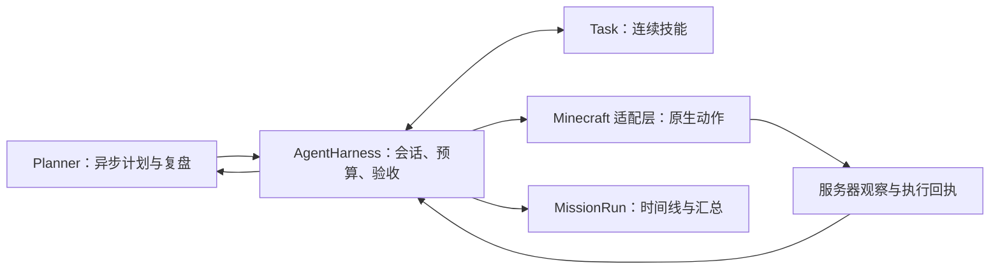

# MC Player Agent

**以 Minecraft 为首个环境的可扩展 agent harness：把模型计划变成可中断、有回执、有验收的玩家任务。**

Extensible agent harness, starting with Minecraft 1.21.1: a headless Java core, configurable profiles, registered skills, and Fabric / NeoForge adapters.

当前版本：**0.4.0-alpha.1**。项目处于持续开发的 Alpha 阶段，重点验证执行可靠性与可追溯性，尚未承诺长期无人值守表现或稳定 API。

## 项目背景与来源

本项目起源于对 [Numen](https://github.com/Dwinovo/minecraft-numen) 的本地玩家接管扩展，现已独立维护构建、Java 命名空间、任务核心、游戏适配层与发行流程。运行时不需要安装 Numen；部分实现仍继承自 Numen，保留相应署名和 LGPL-3.0 许可。本项目是独立维护的衍生项目，非 Numen 官方版本。

这段发展历史属于项目说明的一部分。工程独立不等于全部代码从零原创，详细来源见 [NOTICE](NOTICE) 和 [provenance.json](provenance.json)。

## 要解决的问题

模型能够提出计划，但计划可能过期、动作可能失败，模型声称“完成”也不等于世界状态符合目标。本项目围绕这些情况组织执行：

- **持续执行：** 连续技能持有动作控制权，后台复盘不能随意替换正在执行的技能。
- **观测验收：** 通过服务器观察和动作回执判断结果，DONE 仍需核心检查验收条件。
- **有界运行：** 用显式代码限制会话时长、模型请求和动作数量；取消或切换维度不返还预算。
- **人工接管与复盘：** F9 或物理输入停止接管；每个任务保存独立的 JSONL 时间线与 JSON 汇总。

长期目标是让使用者通过配置组装 Agent，让开发者通过公开接口增加能力。核心仍使用 Minecraft 的动作和证据语义，当前首先把这个环境的扩展闭环做完整。复合目标验收、语义上的无进展检测和真实任务成功率仍需继续完善。

## 快速运行：无需 Minecraft 或模型密钥

需要 **JDK 21**，并配置 `JAVA_HOME`。在包含 `gradlew` 的仓库根目录运行；首次运行需要网络下载依赖。

```bash
bash ./gradlew -p harness test run --args='demo build/demo' --no-daemon
```

Windows PowerShell：

```powershell
.\gradlew.bat -p harness test run --args="demo build/demo" --no-daemon
```

演示使用假模型和模拟背包，运行“计划 → 技能 → 动作回执 → DONE 验收 → 保存记录”。成功输出包含以下字段：

```json
{"simulation": true, "state": "VERIFIED", "steps": 3}
```

记录位于 `harness/build/demo/`。这个演示验证核心执行闭环，不代表真实游戏采集或真实模型调用成功。独立命令行安装与宿主接口见 [HARNESS](docs/HARNESS.md)。

## 自定义与外部扩展

当前提供版本化 JSON 配置、实例级技能注册表和可信 Java `SkillProvider` 扩展。模型、提示词、预算和启用技能在每次任务开始时固定；内置技能通过同一注册表提供，旧技能短名称仍可用。

第一个外部示例不修改核心或游戏实现，组合拾取和返程能力：

```bash
bash ./gradlew -p examples/collect-return :test :run --args='build/demo' --no-daemon
```

它使用模拟世界和假回执验证扩展加载、技能组合、停止及验收。示例 JAR 尚不是可直接放进 mods 的完整模组；第三方游戏安装包和实机表现未验证。

配置、接口、兼容迁移与加载边界见 [扩展指南](docs/EXTENSIONS.md)，可编译源码见 [示例](examples/collect-return/README.md)。扩展在同一 JVM 中运行，只适用于可信代码；技能选择不是权限隔离。

## 当前能力与验证边界

| 能力 | 当前状态 | 证据边界 |
| --- | --- | --- |
| 独立 Java 核心 | 会话调度、异步规划、技能中断恢复、观测验收 | 核心测试与确定性演示 |
| 会话硬预算 | 默认 20 分钟、120 次模型请求、2,000 个动作 | 假时钟和边界回归测试；阈值尚未经过玩法调优 |
| Fabric / NeoForge | Minecraft 1.21.1 双加载器适配 | 本地构建及原生拾取 GameTest |
| 配置与技能扩展 | 配置校验、实例注册、服务发现、外部组合技能示例 | 核心与示例测试；游戏安装与交互待验证 |
| Minecraft 技能 | 采木、合成、地表寻路、避险、基础庇护所、采矿和拾取等已接入 | 尚无系统性的客户端任务成功率数据 |
| 任务记录与世界记忆 | 按存档、玩家、维度保存；每次运行独立 UUID | 已覆盖的规则测试；迁移与长期使用仍需客户端验证 |
| F8 控制台、F9 急停 | 已实现游戏接入 | 客户端视觉、交互及连续接管待实测 |

本次测试数量、构建环境及未验证范围集中记录在 [VALIDATION](docs/VALIDATION.md)。GitHub 云端 CI 需要上传后执行，仓库不展示未经验证的通过徽章。

## 架构



| 目录 | 职责 |
| --- | --- |
| `harness/` | 不导入 Minecraft 的会话核心、动作协议、纯算法、模型连接、记录与单元测试 |
| `game/src/main/` | 服务端观察、原生配方与挖掘计算、拾取回执、公共 Mixin |
| `game/src/client/` | 玩家控制器、控制台、输入接管及 Minecraft 技能实现 |
| `game/src/gametest/` | 原生拾取集成测试，不进入发行 JAR |
| `fabric/`、`neoforge/` | 加载器薄入口与构建配置 |
| `examples/`、`schemas/` | 独立扩展示例、可分享的配置样例与字段契约 |
| `tools/` | 发布打包及仓库边界检查 |

线程、动作所有权、预算计数与回执契约见 [HARNESS](docs/HARNESS.md)；接手阅读顺序见 [HANDOVER](docs/HANDOVER.md)。

## 游戏使用与构建

当前支持 **Minecraft Java 1.21.1 单人世界和本机局域网房主**。Fabric 构建使用 Loader 0.18.1 与 Fabric API 0.116.7+1.21.1；NeoForge 使用 21.1.233。加入别人服务器的客户端尚不支持这套服务器回执。

```bash
bash ./gradlew :harness:test :collect-return-example:test :fabric:build :neoforge:build --no-daemon
```

Windows 将 `bash ./gradlew` 换为 `.\gradlew.bat`。成品在对应加载器的 `build/libs/`，安装没有 `-sources` 后缀的 JAR。开发客户端可运行 `:fabric:runClient` 或 `:neoforge:runClient`。

进入测试存档后，F8 打开任务控制台，配置 DeepSeek 或本机 Ollama，填写目标再执行。F9 或物理输入停止接管。模型服务的费用由使用者承担；API Key 是本机明文文件，不能提交到仓库。

详细安装、配置、数据位置与旧版本迁移见 [USAGE](docs/USAGE.md)。完整构建、双加载器 GameTest 和打包顺序见 [RELEASING](docs/RELEASING.md)。

## 参与开发

准备接手或修改代码，请从 [开发者接手指南](docs/DEVELOPMENT.md) 开始：环境配置、IDE 导入、核心与游戏调试、测试选择和提交约定集中在此。源码调用链与修改入口见 [架构导航](docs/HANDOVER.md)。

```bash
python3 tools/check_repository.py
```

该检查复用发布源码清单，检查模块的显式依赖与可交付的本地文档链接；CI 使用同一命令。

## 维护与下一步

近期工作按可验证结果推进：完成扩展在两个加载器中的安装闭环、客户端急停与配置检查、固定场景下的真实模型任务评测，再依据证据推进模型后端扩展、复合验收和无进展检测。后续阶段的准入条件见 [ROADMAP](docs/ROADMAP.md)，实际游戏评测方法见 [EVALUATION](docs/EVALUATION.md)。这些是计划，尚无真实成功率结论。

欢迎提交最小可复现问题和聚焦的 PR。开发规范见 [CONTRIBUTING](CONTRIBUTING.md)，漏洞和敏感数据处理见 [SECURITY](SECURITY.md)，版本变化见 [CHANGELOG](CHANGELOG.md)。

## 许可证与归属

继承实现按 **LGPL-3.0-only** 提供，分发修改版本时保留相关声明并提供对应源码。完整文本见 [LICENSE](LICENSE) 和 [COPYING](COPYING)，Gradle Wrapper 的许可见 [licenses](licenses/)。Numen 人物、美术、语音与品牌资源不包含在本工程中。

来源清单中的快照比较用于记录提取历史，不能换算为原创率，也不证明独占作者权利。AI 辅助开发不改变上游归属或许可义务。项目的贡献应结合具体改动和验证记录说明。
