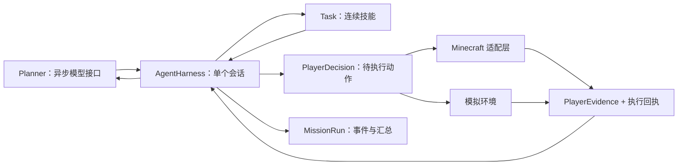

# 独立 Agent Harness

本地整合扩展：[导演任务 API](DIRECTOR_API.md) 的 HTTP 线程仅排队，宿主线程调用 `DirectorGateway.tick()` 后才访问 PlayerControl。它不执行模型规划或游戏动作，不改变原 Harness 的完成验收。导演请求以实例、存档、请求 UUID 和原生 mission UUID 绑定；急停使旧控制版本失效，取消未确认释放时继续占用任务。

当前源码以 **以 Minecraft 为首个环境、可独立运行与扩展的 agent harness** 为维护方向。
游戏适配层仍使用 Minecraft 1.21.1 的原生操作；核心不导入 Minecraft，也不需要启动游戏或连接模型即可验证调度闭环。

当前版本为 `0.4.0-alpha.1`，接口尚未承诺兼容性。实际验证范围见 [VALIDATION.md](VALIDATION.md)，原 0.2.0 的结果不能证明当前代码。

## 运行核心

需要 JDK 21。首次运行会下载 Gradle、Gson 和 JUnit；独立入口不会配置 Fabric、NeoForge 或下载 Minecraft。

在源码根目录运行：

```bash
bash ./gradlew -p harness test run --args='demo build/demo' --no-daemon
```

Windows：

```powershell
.\gradlew.bat -p harness test run --args="demo build/demo" --no-daemon
```

`demo` 使用确定性的假模型和模拟背包，执行“计划 → 连续技能 → 动作回执 → DONE 验收 → 保存记录”。
输出包含 `simulation: true`、结束状态和记录目录；超过 100 个调度刻或验收失败会报错。
它验证核心执行循环，**不代表在真实游戏里采集成功，也不调用真实模型**。

模拟记录位于 `harness/build/demo/mcplayeragent/runs/<UUID>/`。

生成可独立启动的命令行目录：

```bash
bash ./gradlew -p harness installDist --no-daemon
./harness/build/install/mc-player-agent-harness/bin/mc-player-agent-harness demo /tmp/mc-agent-demo
```

## 职责边界



| 位置 | 负责 | 不负责 |
| --- | --- | --- |
| `AgentHarness` | 计划队列、模型请求节奏、复盘隔离、技能调度、中断恢复、任务验收、运行记录 | 游戏按键、渲染、服务端线程调度 |
| `Planner` | 接收结构化观察，异步返回已解析的 `PlayerPlan` | 修改会话、直接执行动作 |
| `Adapter` | 观察环境、创建技能、保存目标、释放动作、展示公开消息 | 判定整个任务成功 |
| `PlayerControl` | 授权和人工接管、逐刻原生动作、服务器观察、动作结果检测 | 自行维护另一套模型计划循环 |
| `PlayerTasks.Task` | 根据观察和上一回执推进一个连续技能 | 直接抢占其他技能或自行请求模型 |
| `MissionRun` | 保存 JSONL 时间线与 JSON 汇总 | 执行任务、保存密钥或原始模型回复 |

`harness` 内的会话状态和 `PlayerTasks`／`SkillRegistry` 属于实例。游戏每次接管创建并封闭注册表；`PlayerControl`、游戏世界桥接及运行记录入口仍面向单客户端，不支持多个 agent 同时控制一个玩家。

## 接口与线程约定

1. 每个任务创建一个 `MissionRun` 和一个 `AgentHarness`，模型密钥仅留在 Planner 的连接实现中。
2. 由同一宿主线程调用 `tick`、`complete`、`interrupt`、`resetContext` 和 `stop`。
3. `tick(evidence)` 返回一个新动作或 `null`。动作只交付一次；在回执返回前，不会交付下一动作。
4. 适配器执行动作，用 `complete(outcome, detail, receipt, startKey, evidence)` 回传实际结果。`startKey` 表示动作开始时的可比较状态，供重复失败检测使用。
5. 模型 Future 在调度刻中读取。HTTP 完成线程不修改会话；停止、危险中断和环境切换会撤销待处理请求。
6. 取消请求后仍可能存在已发出的网络请求，但其迟到结果不能重新取得动作控制权。
7. 运行记录异步写盘。命令行或测试结束前应等待 `MissionRun.flushed()`，正常游戏刻不能阻塞等待文件写入。

Minecraft 的适配器直接位于 `PlayerControl.start()`；无游戏适配示例位于 `HarnessMain`。

## 执行约束

- 活跃技能拥有动作执行权，后台复盘只更新任务步骤和公开进度说明，不接受其动作或替换验收条件。
- 每个环境上下文首次得到的非空 `goal_check` 会保留，后续计划不能将它换成更容易的条件；更换用户目标应开始新任务。
- `DONE` 最终由核心重新检查 `goal_check`。即使动作级 `until` 成立，或适配器错误上报成功，也不能代替总任务验收。
- 缺少验收条件时为 `UNVERIFIED`，条件不成立时记录失败并允许重新规划；相同状态的重复失败仍按现有规则停止。
- 危险会暂停当前技能，安全恢复后调用该技能的 `resumed()` 重新核验环境。脱险失败会停止任务。
- 重生或切换维度撤销旧动作、旧规划和旧观察基线，重新读取环境目标；坐标条件不会跨维度沿用。

这些约束保护执行闭环，但不能证明模型提出的验收条件覆盖了完整自然语言目标。会话硬预算已实现；复合验收条件、基于语义进展的停滞检测仍待完善。

## 会话硬预算

`AgentHarness.DEFAULT_LIMITS` 为 20 分钟、120 次模型请求、2,000 个动作。这是可检查的 Alpha 保护阈值，尚无真实玩法调优结论。默认构造器使用这些值；Minecraft 接入从已校验的 `AgentProfile.limits` 读取上限，缺省时相同。

自定义 Java 宿主可在构造时传入正数上限：

```java
var harness = new AgentHarness(goal, saved, planner, adapter, recording,
        new AgentHarness.Limits(600_000, 60, 1000));
```

- `maxRuntimeMillis` 使用单调时钟，从创建会话开始计时，包含等待与暂停时间；在 `tick` 和 `complete` 检查。宿主线程停止推进或被阻塞时不能即时抢占，恢复推进后先检查期限。
- 模型预算按实际调用 Planner 的次数计数，包含初始规划、复盘、失败和取消。已收到的最后一个允许回复仍可执行；只有下一次调用会超额时才停止。
- 动作预算按 `tick` 向适配器交付的动作计数，包含技能内动作和 DONE；技能启动本身不额外计数。达到上限的最后一个动作可以正常验收，下一动作不能再交付。
- 重生、切换维度和遇险不会返还预算。不同实例各自计数。模型不能修改这些上限。
- 超限调用现有停止流程：取消待处理 Future、停止当前和挂起的技能、清除队列、释放适配器输入；运行结果为 `INTERRUPTED`。`end_reason` 中包含 `BUDGET_EXHAUSTED` 和具体上限种类。
- 即使观测条件成立，超过时限后送达的 DONE 回执也不能把会话标为 `VERIFIED`。停止不会撤销已执行的游戏动作或已发送网络请求。

观察中的 `execution_budget` 提供上限、已用时间、已发起请求和已交付动作。`execution_metrics.requests` 仍统计已消费的模型响应，两种计数不能互换。次数上限不等于 token 或费用上限。

## 继续维护

新增调度规则首先在 `AgentHarnessTest` 用假时钟、模型 Future、假技能和观察验证，再接入游戏。
新增玩法技能继续使用 `PlayerTasks.Task`，纯算法放 `harness`，Minecraft API 操作放 `game`。
可信技能可以通过 `SkillProvider` 与 ServiceLoader 注册；配置、发现、版本和迁移契约见 [EXTENSIONS](EXTENSIONS.md)。不引入第二套任务循环，远程控制与不可信代码隔离尚未实现。

完整游戏构建仍从源码根目录运行：

```bash
bash ./gradlew :harness:test :collect-return-example:test :fabric:build :neoforge:build --no-daemon
```

修改原生拾取或加载器接入时，顺序运行两个 `runGameTestServer`。客户端交互和长期生存需要单独实机验证。

CI 增加独立核心任务，运行全部核心测试与模拟闭环；游戏构建任务继续检查两个加载器。

来源说明见 `NOTICE`：`AgentHarness` 的调度逻辑从本项目现有 `PlayerControl` 提取，沿用实际来源与 LGPL 声明。
